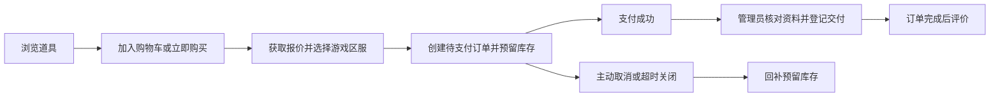

# gcSystem 游戏道具商城

gcSystem 是一个前后端分离的虚拟游戏道具商城，包含独立商城用户端、管理后台和 Spring Boot 后端。项目覆盖商品浏览、购物车、游戏区服选择、订单支付、人工交付、评价与库存管理，适合课程实践、功能演示和二次开发。

**当前基线：2026年10月23日，接口契约3.0.0，数据库迁移V007。** 后端模块统一命名为 `gc-*`，Maven groupId 与 Java 包前缀为 `com.gc`，商城业务包为 `com.gc.gameshop`。两端共用若依原生账号，普通用户只能使用商城，后台按角色权限开放。

- [功能展示 Word 文档](./docs/功能展示/游戏道具商城功能展示.docx)：30页，包含29个功能项、30张实际页面截图、功能说明与操作入口。
- [接口设计](./docs/api/README.md) · [OpenAPI](./docs/api/openapi.yaml) · [数据库设计](./docs/database/README.md) · [完整数据迁移](./sql/README.md)。
- 项目仓库：[followTheWind223/gcSystem](https://github.com/followTheWind223/gcSystem)。

## 目录

- [项目功能](#项目功能)
- [业务流程与规则](#业务流程与规则)
- [技术栈与工程结构](#技术栈与工程结构)
- [后端分层设计](#后端分层设计)
- [账号与权限](#账号与权限)
- [环境配置与本地启动](#环境配置与本地启动)
- [数据库初始化与迁移](#数据库初始化与迁移)
- [图片与展示数据](#图片与展示数据)
- [接口与代理约定](#接口与代理约定)
- [构建与部署](#构建与部署)
- [验证方式与记录](#验证方式与记录)
- [常见问题](#常见问题)
- [文档索引](#文档索引)
- [项目边界与源码来源](#项目边界与源码来源)

## 项目功能

### 商城用户端

用户端位于 `systemUI/`，使用独立的深色商城界面，适配桌面与手机。公开商品页面可匿名浏览，购物车、订单和玩家中心需要登录。

| 功能 | 实现内容 | 页面入口 |
| --- | --- | --- |
| 首页 | 轮播推荐、推荐游戏、商品展示；轮播支持按钮、指示器、鼠标拖拽与触摸切换 | `/` |
| 商品检索 | 关键词、游戏分类、价格区间、热销/价格/上架时间排序与分页，筛选同步URL | `/props` |
| 商品详情 | 图片、价格库存、展示规格、详情、公开评价、数量选择、加购与立即购买 | `/props/:propId` |
| 注册登录 | 若依原生认证、图形验证码、普通用户注册、安全登录跳回 | `/register`、`/login` |
| 购物车 | 增减数量、勾选结算、删除条目、失效商品提示与服务端金额汇总 | `/cart` |
| 确认订单 | 5分钟报价、游戏账号、角色名、区服下拉选择、订单备注与确认 | `/checkout` |
| 订单支付 | 金额核对、支付倒计时、“去支付”入口、结果反馈与取消订单 | `/orders/:orderNo/pay` |
| 订单详情 | 商品与区服快照、支付/取消状态、交付说明、时间线和评价入口 | `/orders/:orderNo` |
| 玩家中心 | 个人资料、头像、密码修改、本人订单和本人评价 | `/me/profile`、`/me/password`、`/me/orders`、`/me/reviews` |

区服选项由后台按游戏维护；跨游戏结算时分别选择区服，没有可用区服时阻止提交。页面覆盖加载、空态、请求失败、未登录、缺货、下架、报价变化和订单过期等状态。

### 管理后台

后台位于 `adminsystemui/`，基于 RuoYi-Vue3 二次开发。登录页、标识、默认展示和工作台已商城化；八个商城业务页面均包含操作区域、权限按钮、查询、分页及必要的表单和详情。

| 功能 | 主要操作 | 后台路由 |
| --- | --- | --- |
| 商城工作台 | 在售商品、待交付/待支付订单、会员统计和业务快捷入口 | `/index` |
| 游戏分类 | 图标、名称、排序、推荐、启停、增删改查和管理区服入口 | `/gameshop/categories` |
| 游戏区服 | 按游戏维护名称、排序、备注、状态，支持新增、修改、启停和软删除 | `/gameshop/game-servers` |
| 道具商品 | 内容、图片、规格、价格、交付要求、上下架和库存调整 | `/gameshop/props` |
| 首页轮播 | 推荐图片、标题、目标商品、排序和启停 | `/gameshop/banners` |
| 商城会员 | 档案查询、详情、联系方式脱敏及商城访问启停 | `/gameshop/members` |
| 商城订单 | 查询、查看明细、取消待支付订单及登记交付 | `/gameshop/orders` |
| 商品评价 | 查询、查看、隐藏不适宜公开的评价并保留原因 | `/gameshop/reviews` |
| 库存流水 | 初始库存、下单扣减、取消回补和人工调整的追溯 | `/gameshop/stock-logs` |

系统管理保留账号、角色、菜单、字典、参数、公告和日志等功能。部门管理、岗位管理、系统监控、系统工具及其后代菜单已移除，部门相关前端展示已清理；底层基础数据与商城关单任务保留。

## 业务流程与规则



### 订单与库存

- 状态固定为 `1 待支付 → 2 已支付/待交付 → 4 已完成`；待支付订单可以转为 `3 已取消`。
- 下单扣减可售库存，取消或超时关闭回补一次；支付不重复扣库存，首次成功支付才增加销量。
- 报价有效期默认5分钟，不占库存；订单默认30分钟未支付关闭，Quartz每分钟扫描超时订单。
- 订单、明细、库存和流水在Service事务内写入。库存使用条件更新，多商品按固定顺序加锁，任一校验失败整单回滚。
- 下单通过 `requestKey` 和请求摘要防重：同一会员同键同内容返回原订单，同键不同内容拒绝。结果不确定时重试原请求，不生成新键再次下单。
- 商品名称、封面、规格、单价和区服保存订单快照，商品改名或区服停用、删除不改写历史订单。
- 普通商品编辑不覆盖库存和销量；人工增减库存通过专门操作，填写原因并记录流水。

### 交付与评价

- 按商品要求收集游戏账号、区服和角色名，不收集游戏密码，不涉及实体物流。
- 区服必须属于对应游戏且当前启用；下单事务重新检查，不能仅依赖前端下拉框。
- 已支付订单由管理员登记交付说明后完成，用户端不能自行完成订单。
- 评价仅限本人已完成订单的明细，每条明细一次；隐藏评价不释放重复评价额度。
- 页面入口统一显示“去支付”。**底层仍是项目演示支付，没有接入微信、支付宝等真实收款通道。**

## 技术栈与工程结构

### 技术栈

版本来自当前工程配置，完整依赖以各工程的 `pom.xml`、`package.json` 和锁文件为准。

| 范围 | 技术与版本 |
| --- | --- |
| 语言与构建 | JDK 17，Maven Wrapper固定Maven 3.9.10 |
| 后端框架 | Spring Boot 3.5.16、Spring Security、Jakarta Validation |
| 数据访问 | MyBatis、XML Mapper、PageHelper、Druid、MySQL |
| 会话与任务 | Redis、若依TokenService、Quartz |
| 内容处理 | jsoup富文本清洗、ImageIO图片解码与重新编码 |
| 商城用户端 | Vue 3.5.44、Vite 6.4.5、Vue Router 4.6.4、Pinia 3.0.4、Axios 1.20.0、Element Plus 2.13.1 |
| 管理后台 | Vue 3、Vite、Element Plus、Pinia、Vue Quill、ECharts，基于RuoYi-Vue3 |
| 前端环境 | Node.js 24.20.0、npm 11.19.0，两端各自维护 `package-lock.json` |
| 数据库 | MySQL至少8.0.16以执行CHECK；本机实际验证8.3.0 |
| Redis | 本机实际验证5.0.14.1，其他目标版本在部署环境验证 |

### 目录结构

```text
gcSystem/
├── system/                         # Maven多模块后端
│   ├── gc-admin/                   # Spring Boot启动与接口装配
│   ├── gc-framework/               # 安全、会话与框架配置
│   ├── gc-system/                  # 账号、角色、菜单等系统业务
│   ├── gc-common/                  # 公共类型、注解和工具
│   ├── gc-quartz/                  # 定时任务基础设施
│   ├── gc-generator/               # 保留的代码生成基础模块
│   ├── gc-shop/                    # 商城独立业务模块
│   ├── sql/                        # 上游基线、V001–V007迁移和可选演示数据
│   ├── scripts/                    # 认证迁移和商品显示数据导入
│   ├── assets/display-catalog/     # 游戏道具原图与清单
│   ├── data/uploads/               # 本地上传文件，运行时目录
│   ├── .env.example                # 后端配置模板
│   └── start.ps1                   # Windows构建及启动入口
├── systemUI/                       # 独立商城用户端
│   ├── src/                        # 页面、组件、API、状态、路由及显式Mock
│   ├── public/                     # 静态图片和品牌标识
│   ├── tests/                      # 单元、E2E和真实后端联调
│   └── deploy/                     # 用户端Nginx示例
├── adminsystemui/                  # 管理后台
│   └── src/views/gameshop/         # 商城业务页面
├── sql/                            # 完整快照、上传图片包及恢复说明
├── deploy/nginx/                   # 管理端Nginx示例
├── docs/                           # 功能展示、数据库、接口与验收
├── README.md                       # 项目使用入口
└── AGENTS.md                       # 开发约束与阶段记录
```

三个工程独立构建。后端为多模块单体，未引入微服务、消息队列、搜索引擎或分布式事务；`gc-shop` 由 `gc-admin` 装配，基础模块不反向依赖商城业务。

## 后端分层设计

商城源码位于 `system/gc-shop/src/main/java/com/gc/gameshop/`，接收、业务、查询、持久化和返回对象分开定义。

| 层次或目录 | 职责 |
| --- | --- |
| `controller` | HTTP绑定、身份、权限、状态码和资源Location |
| `model/dto` | 请求字段允许列表、必填项和格式校验 |
| `convert` | DTO、Command、Result、VO之间的显式转换 |
| `model/command`、`model/bo` | Service输入及内部业务对象 |
| `service`、`service/impl` | 业务规则、事务、状态转移与并发控制 |
| `model/query` | Mapper查询条件与分页参数 |
| `mapper`、`src/main/resources/mapper/gameshop` | 参数绑定SQL、关联查询、条件更新与行锁 |
| `persistence/entity` | 数据库实体和查询结果行 |
| `model/result` | Service输出，不直接作为网页响应 |
| `model/vo`、`web` | 响应允许字段、分页外壳与错误协议 |
| `security`、`config`、`task` | 商城业务身份、配置和关单任务入口 |

调用链为 `Controller → Service → Mapper/XML → MySQL`。Controller不直接访问Mapper，Service不依赖网页DTO/VO或Servlet，不使用同一个数据库实体贯穿各层。详见 [商城模块说明](./system/gc-shop/README.md)。

## 账号与权限

两端共用若依 `sys_user` 和原生 `/captchaImage`、`/register`、`/login`、`/getInfo`、`/logout`。`mall_member.sys_user_id` 唯一关联系统账号，订单继续以会员主键区分业务归属。

| 身份 | 使用范围 |
| --- | --- |
| 访客 | 首页、游戏分类、道具详情和公开评价 |
| 普通用户 `common` | 商城购物、本人资料、购物车、订单和评价，无后台权限 |
| 管理角色 | 按授权访问后台页面与接口，商城权限为 `mall:*` |
| 超级管理员 | 后台与系统管理，也可以同一账号登录商城 |

注册固定分配普通角色，不能通过提交角色、部门或用户ID获取管理权限。账号禁用、删除或改密后，旧会话在后续访问时失效；商城档案启停独立控制商城访问。

用户端令牌仅在Pinia内存中，刷新受保护页面后需要重新登录，不写localStorage、sessionStorage、Cookie或URL，也不复用后台存储键。邮箱只作为联系信息，不启用邮箱验证码和邮箱找回；遗忘密码由管理员重置，已登录用户可凭原密码改密。

全新初始化环境的后台种子账号为 `admin / admin123`；恢复完整备份时以备份中的密码为准，部署后应更换初始密码。详见 [统一认证与迁移规则](./docs/api/若依统一认证.md)。

## 环境配置与本地启动

### 环境准备

准备JDK 17、Node.js 24.20.0、npm 11.19.0、MySQL和Redis。Maven由Wrapper下载。先选择后文的一种数据库初始化或恢复方式，再启动应用。

```powershell
git clone https://github.com/followTheWind223/gcSystem.git
cd gcSystem
```

| 服务 | 默认地址或端口 |
| --- | --- |
| 商城用户端 | [http://127.0.0.1:5173](http://127.0.0.1:5173) |
| 管理后台 | [http://127.0.0.1:5174](http://127.0.0.1:5174) |
| 后端 | `http://127.0.0.1:8080` |
| MySQL | `127.0.0.1:3306`，数据库 `gc_system` |
| Redis | `127.0.0.1:6379`，应用默认DB 6 |

### 后端配置

从仓库根目录执行，已有 `.env` 时保留原配置：

```powershell
cd system
if (-not (Test-Path -LiteralPath .env)) {
    Copy-Item -LiteralPath .env.example -Destination .env
}
```

编辑 `system/.env`，按 [.env.example](./system/.env.example) 填写本机参数。文件使用 **Java properties语法**，值不加引号，Windows路径使用 `/`；进程环境变量优先。真实 `.env` 被Git忽略。

| 配置 | 作用 |
| --- | --- |
| `SPRING_PROFILES_ACTIVE` | 本机 `dev`，部署 `prod` |
| `DB_HOST`、`DB_PORT`、`DB_NAME`、`DB_USERNAME`、`DB_PASSWORD` | 开发数据库连接 |
| `DB_URL` | 完整JDBC地址，覆盖分项配置；`prod`要求提供 |
| `DB_USE_SSL`、`DB_ALLOW_PUBLIC_KEY_RETRIEVAL` | 按实例设置TLS、公钥检索；本机开发可使用对应开发选项 |
| `REDIS_HOST`、`REDIS_PORT`、`REDIS_DATABASE`、`REDIS_PASSWORD` | Redis连接与会话库 |
| `TOKEN_SECRET` | 若依HS512签名，使用至少64字节随机数据的Base64值 |
| `TOKEN_EXPIRE_MINUTES` | 会话有效期，默认30分钟 |
| `SERVER_ADDRESS`、`SERVER_PORT` | 监听地址与端口，默认 `127.0.0.1:8080` |
| `UPLOAD_PATH` | 上传根目录，默认 `./data/uploads` |
| `LOG_PATH`、`LOG_LEVEL` | 日志目录与业务日志级别 |
| `API_DOCS_ENABLED` | 开发接口文档开关，生产配置关闭在线文档 |

模板保留的 `GAMESHOP_*` 为旧认证兼容配置，当前3.0不签发独立商城令牌，旧邮箱开关不控制若依注册或找回。前端 `.env*` 只存公开配置，不复制数据库密码或后端密钥。

可在本机PowerShell生成签名密钥，并将结果填入私密配置：

```powershell
$randomBytes = New-Object byte[] 64
$generator = [System.Security.Cryptography.RandomNumberGenerator]::Create()
$generator.GetBytes($randomBytes)
[Convert]::ToBase64String($randomBytes)
$generator.Dispose()
```

### 启动后端

在 `system/` 执行，JDK路径按本机安装位置修改：

```powershell
$env:JAVA_HOME = 'D:\java'
.\start.ps1
```

没有产物时脚本会自动构建；源码修改后运行 `.\start.ps1 -Build`，也可先执行 `.\mvnw.cmd -B clean package`。当前可执行包为 **`system/gc-admin/target/gc-admin.jar`**，工作目录必须是 `system/`，否则相对配置、上传及日志路径可能失效。

IDE启动类为 `com.gc.RuoYiApplication`，Working directory设为 `system/`。Linux可从该目录使用 `./mvnw -B clean package` 构建，然后启动：

```bash
java -Duser.timezone=Asia/Shanghai -jar gc-admin/target/gc-admin.jar
```

### 启动商城用户端

从仓库根目录另开终端：

```powershell
cd systemUI
npm ci
npm run dev
```

默认连接真实后端，`npm run dev:api` 也是该模式。请求失败显示错误，不自动回退演示数据。只有显式执行 `npm run dev:demo -- --port 5176` 才启用内存Mock，不能用演示模式结果代替真实数据验收。

### 启动管理后台

从仓库根目录另开终端：

```powershell
cd adminsystemui
npm ci
npm run dev
```

两端 `.env.local` 可设置 `DEV_HOST`、`DEV_PORT`、`DEV_PROXY_TARGET`。例如 `DEV_PROXY_TARGET=http://127.0.0.1:8081` 指向另一后端端口，修改后重启Vite。两端各自安装依赖，锁文件随工程维护，npm默认禁止依赖安装脚本。

首次配置业务建议顺序：**游戏分类 → 游戏区服 → 上传图片并创建商品 → 轮播 → 用户注册下单 → 后台登记交付**。

## 数据库初始化与迁移

当前结构共 **47张表**，其中商城为 **15张业务表和1张版本表，183字段**。以V001基线与V002–V007增量共同组成，详情见 [字段字典](./docs/database/字段字典.md)。

| 领域 | 主要表 | 职责 |
| --- | --- | --- |
| 身份与档案 | `sys_user`、`sys_role`、`sys_menu`、`mall_member` | 统一账号、后台权限与商城业务归属 |
| 游戏与商品 | `mall_game_category`、`mall_game_server`、`mall_prop`、`mall_prop_image` | 游戏、区服、道具与多图 |
| 展示与媒体 | `mall_banner`、`mall_media` | 轮播及文件元数据 |
| 购物车 | `mall_cart_item` | 会员当前商品、数量与勾选状态 |
| 订单 | `mall_order`、`mall_order_item`、`mall_order_log` | 金额、交付资料、快照与状态记录 |
| 支付交付 | `mall_payment_record`、`mall_order_delivery` | 成功支付事实与管理员交付说明 |
| 库存评价 | `mall_stock_log`、`mall_review` | 库存变动及购买者反馈 |
| 版本 | `mall_schema_history` | 已完成迁移记录 |

### 方式一 恢复现有完整快照

根目录 [sql/](./sql/README.md) 保存 **2026-10-23 01:39:35（Asia/Shanghai）** 的完整快照，包含47张表、470条记录及7个上传图片。它是固定时刻的备份，后续数据变更需要重新导出。

1. 停止目标后端，导入 [gc_system_full.sql](./sql/gc_system_full.sql)。
2. 将 [uploads.zip](./sql/uploads.zip) 解压到 `system/data/`，使最终路径为 `system/data/uploads/`，保留内部层级。
3. 配置目标MySQL账号、Redis和 `.env`，启动匹配的代码并重新登录。

从仓库根目录打开MySQL客户端，然后执行恢复：

```powershell
mysql --default-character-set=utf8mb4 -h 127.0.0.1 -P 3306 -u root -p
```

```sql
SOURCE sql/gc_system_full.sql;
```

**SQL包含建库、`USE gc_system`和替换同名表语句，应导入空环境或确认可覆盖的目标库。恢复后已含V001–V007，不再运行上游SQL、增量迁移或D001。** 逐表恢复记录、文件SHA-256和其他路径示例见 [完整恢复说明](./sql/README.md)及[校验结果](./sql/校验结果.json)。

### 方式二 从空库初始化

适用于新开发环境，不恢复现有业务数据。从仓库根目录连接MySQL后按顺序执行：

```sql
SOURCE system/sql/create-database.sql.example;
USE gc_system;
SOURCE system/sql/upstream/ry_20260417.sql;
SOURCE system/sql/upstream/quartz.sql;
SOURCE system/sql/migrations/V001__create_mall_tables.sql;
SOURCE system/sql/migrations/V002__register_order_expiry_job.sql;
SOURCE system/sql/migrations/V003__register_admin_menus.sql;
SOURCE system/sql/migrations/V004__customize_admin_brand.sql;
SOURCE system/sql/migrations/V005__prune_admin_menus.sql;
SOURCE system/sql/migrations/V006__game_servers.sql;
SOURCE system/sql/migrations/V007__ruoyi_storefront_identity.sql;
SELECT version, script_name FROM mall_schema_history ORDER BY version;
```

上游SQL含 `DROP TABLE`，只能用于空库；启动过程不会自动执行迁移。已有环境只应用缺少的版本，**V007不可直接重复执行**。V006环境升级统一认证时，先停止后端，再按 [增量说明](./system/sql/README.md) 使用 `system/scripts/migrate_ruoyi_identity.py` 备份、迁移与核对身份。

`D001__mall_demo.sql` 仅供隔离开发演示，不是必需步骤。需要时在V006和V007之前导入，让演示游戏先建立区服，再迁移账号。发现商城与系统同名账号时应先核实，不能自动合并身份。

## 图片与展示数据

原图与清单位于 [system/assets/display-catalog](./system/assets/display-catalog/README.md)。现有展示数据包括3个游戏、6件道具、3条轮播和7张图片。区服迁移为当时已有游戏建立一区、二区、三区，可在后台修改；新游戏需手动添加区服。

- 实际文件默认在 `system/data/uploads/mall/YYYY/MM/DD/`，数据库保存元数据与相对路径。
- 对外通过 `/api/mall/media/{fileName}` 读取，两个前端保留该代理前缀，不暴露本机磁盘路径。
- 上传校验类型、内容、大小与尺寸，解码后重新编码；后台提供缩略图和预览。
- 迁移时同时搬迁数据库与上传文件，仅恢复SQL会导致图片缺失。
- `system/scripts/seed_display_catalog.py` 通过正式接口上传与创建，使用断点文件避免重复导入；已有内容维护方法见素材说明，不重置库存或重导交易样本。

## 接口与代理约定

当前 [OpenAPI](./docs/api/openapi.yaml) 收录 **64个操作：23个用户端业务、34个后台商城、7个若依复用操作**。商城接口按REST资源组织，若依系统接口保留原协议。

| 用途 | 浏览器路径 | 后端路径 | 处理 |
| --- | --- | --- | --- |
| 商城认证 | `/api/auth/login`、`/api/auth/register`等 | `/login`、`/register`等 | 去掉 `/api/auth` |
| 商城业务 | `/api/mall/**` | `/api/mall/**` | 保留前缀 |
| 商城图片 | `/api/mall/media/**` | `/api/mall/media/**` | 保留前缀 |
| 后台登录与系统业务 | `/admin-api/login`、`/admin-api/system/**` | `/login`、`/system/**` | 去掉 `/admin-api` |
| 后台商城 | `/admin-api/mall/**` | `/mall/**` | 去掉 `/admin-api` |

认证使用 `Authorization: Bearer <token>`，登录成功的token在响应顶层。普通商城响应与分页分别为：

```json
{"code":200,"msg":"操作成功","data":{"propId":"1","price":"129.00"}}
```

```json
{"code":200,"msg":"查询成功","rows":[],"total":0}
```

商城错误使用真实HTTP状态及对应 `code`，通过 `errorCode` 区分原因，例如：

```json
{"code":409,"msg":"所选游戏区服已停用或不存在，请重新选择。","errorCode":"MALL_SERVER_UNAVAILABLE","data":null}
```

ID为十进制字符串，金额为两位小数字符串，时间携带 `+08:00` 偏移。分页使用 `pageNum/pageSize`，每页最多50条，排序使用白名单。首次创建一般为HTTP 201，成功响应体code仍为200；无内容操作返回 `data:null`。

若依接口可能HTTP 200但业务code失败，两端都要检查业务code；后台菜单隐藏不代替服务端鉴权。本人订单、购物车、资料和评价始终校验归属。字段、权限及完整JSON见 [用户端详细接口](./docs/api/用户端接口详细说明.md)和[管理端详细接口](./docs/api/管理端接口详细说明.md)。

## 构建与部署

在各自工程目录执行：

| 工程 | 命令 | 产物 |
| --- | --- | --- |
| 后端 | Windows：`.\mvnw.cmd -B clean package`；Linux：`./mvnw -B clean package` | `system/gc-admin/target/gc-admin.jar` |
| 用户端 | `npm ci`，然后 `npm run build` | `systemUI/dist/`，默认真实API模式 |
| 管理端生产版 | `npm ci`，然后 `npm run build:prod` | `adminsystemui/dist/` |
| 管理端预发布 | `npm run build:stage` | `adminsystemui/dist/` |

部署时分别托管两个 `dist/` 并运行后端jar，使用 `prod` 配置、目标 `DB_URL`、独立密钥及正确上传目录。`vite preview` 只预览静态产物，不是带完整API代理的生产服务。

- [用户端Nginx示例](./systemUI/deploy/nginx.conf.example)：SPA回退、静态资源、`/api/auth/`去前缀、`/api/mall/`保留前缀。
- [管理端Nginx示例](./deploy/nginx/admin.conf.example)：SPA回退、`/admin-api/`去前缀及商城图片代理。

示例按站点根路径部署；更改子路径时同步检查Vite base、Vue路由与Nginx。远程访问按部署方式调整监听地址，默认仅本机。目标环境的HTTPS、Nginx和MySQL版本需要单独联调。

## 验证方式与记录

### 当前检查入口

商城用户端从 `systemUI/` 执行：

```powershell
npm test
npm run test:e2e
npm run test:live
```

- `npm test`：金额精度、重定向、凭证格式和媒体地址。
- `test:e2e`：页面、响应式、轮播和Axios契约，使用显式Mock或拦截，不等于真实事务验收。
- `test:live`：默认运行当前若依统一认证的真实联调，也可使用 `python tests/live/run.py --ruoyi-auth`。

真实联调依赖构建好的 `gc-admin.jar`、`system/.env`、MySQL/Redis、Python测试依赖和本机Chrome；管理端检查还需5174开发服务。从仓库根目录运行 `python -m pip install -r system/gc-shop/tests/requirements.txt` 安装Python依赖。脚本使用随机 `gc_ui_test_*` 库、空闲Redis DB 7–15、18090后端和15173用户端，结束后清理自己的资源。

后端在 `system/` 执行 `.\mvnw.cmd -B package`，包含模块内已有测试；管理端没有独立test/lint脚本，以构建和浏览器联调验证。

### 验证记录及适用版本

| 记录 | 范围 |
| --- | --- |
| [统一认证](./docs/validation/ruoyi-auth-integration.json) | 3.0.0/V007，40项真实接口/数据库检查及两端浏览器验证 |
| [用户端验证](./systemUI/docs/verification.md) | 构建、页面、交互和统一认证的阶段记录 |
| [区服集成](./docs/validation/game-servers-integration.json) | 2.2.0阶段146项检查、168次响应Schema检查，包含当时的并发与快照验证 |
| [后台部门清理](./docs/validation/admin-no-department-ui.json) | 部门展示及相关请求清理 |
| [备份恢复](./sql/校验结果.json) | 固定快照的逐表恢复与文件校验 |
| [功能展示文档](./docs/validation/function-showcase.json) | 30页Word、30张截图和逐页排版检查 |

`system/gc-shop/tests/integration.py` 仍保留旧独立会员认证调用，尚未整体适配3.0，不能作为当前完整交易回归入口。`docs/api/validation-result.json` 是2.2.0静态契约检查；历史通过数量不代替当前版本复测。统一认证验收与旧交易验收分别查阅对应记录。

## 常见问题

| 现象 | 核查内容 |
| --- | --- |
| 配置缺失或后端未读到环境文件 | 从 `system/` 启动，确认 `.env` 存在且采用properties语法，值不额外加引号 |
| Java版本不支持 | `JAVA_HOME` 指向JDK 17，避免旧Java抢先；核对 `java -version` |
| MySQL公钥检索或连接失败 | 核对数据库、账号权限、`DB_URL`、TLS及公钥检索选项 |
| 普通用户不能登录后台 | `common`只使用商城，由管理员为管理账号分配角色与功能权限 |
| 刷新商城要求重新登录 | 用户端令牌只在内存，这是当前设计；不与后台共享前端会话存储 |
| 图片404 | 检查媒体元数据、`UPLOAD_PATH`、实际文件和保留 `/api/mall/` 的代理 |
| 新游戏没有区服可选 | 后台为对应游戏新增并启用区服，再重新获取报价 |
| 后台缺少商城菜单 | 检查V003/V006迁移和角色菜单权限，重新登录或刷新菜单 |
| 前端端口占用 | 两端启用strictPort；复用现有服务或通过 `.env.local` 修改 `DEV_PORT` |
| 忘记密码 | 联系管理员在系统用户管理中重置，当前没有邮箱找回 |

## 文档索引

| 文档 | 内容 |
| --- | --- |
| [功能展示Word](./docs/功能展示/游戏道具商城功能展示.docx) | 用户端与后台截图、说明与操作入口 |
| [数据库设计](./docs/database/README.md)、[字段字典](./docs/database/字段字典.md) | 表关系、字段、约束与索引 |
| [完整恢复](./sql/README.md)、[增量SQL](./system/sql/README.md) | 快照迁移、空库初始化与升级 |
| [接口设计](./docs/api/README.md)、[OpenAPI](./docs/api/openapi.yaml) | 字段、状态码、权限与契约 |
| [用户端详细接口](./docs/api/用户端接口详细说明.md)、[管理端详细接口](./docs/api/管理端接口详细说明.md) | 逐接口参数及完整JSON |
| [统一认证](./docs/api/若依统一认证.md)、[区服与结算](./docs/api/游戏区服管理与结算.md) | 身份、权限及按游戏选择区服规则 |
| [商城模块](./system/gc-shop/README.md)、[用户端工程](./systemUI/README.md) | 分层、运行与测试 |
| [模块与包名重构](./docs/模块与包名重构.md) | `gc-*`模块、`com.gc`包名、启动方式与旧会话兼容 |
| [用户端交接](./docs/用户端开发交接.md) | 页面映射与协作约定 |
| [环境验证](./docs/环境配置与验证.md)、[后端后台验收](./docs/后端与后台验收.md) | 环境与阶段检查 |
| [架构与流程](./docs/开发流程与架构设计.md)、[AGENTS.md](./AGENTS.md) | 技术决策、约束和历史记录 |
| [源码来源](./docs/上游源码记录.md)、[原始需求](./docs/开题(2).doc) | 固定上游提交、许可证与需求 |

## 项目边界与源码来源

当前为单商品单库存，规格用于展示，管理员人工交付。真实支付、退款、多商户、多规格SKU、自动卡密、自动游戏发货、实时库存推送与邮件找回属于后续扩展，未作为当前已完成功能。

后端来源为RuoYi-Vue的 `springboot3` 分支，管理端来源为RuoYi-Vue3；固定提交和本地改动见 [源码记录](./docs/上游源码记录.md)。上游MIT许可及版权声明保留于 [system/LICENSE](./system/LICENSE) 与 [adminsystemui/LICENSE](./adminsystemui/LICENSE)，项目自身尚未另行选定整体开源许可证。
