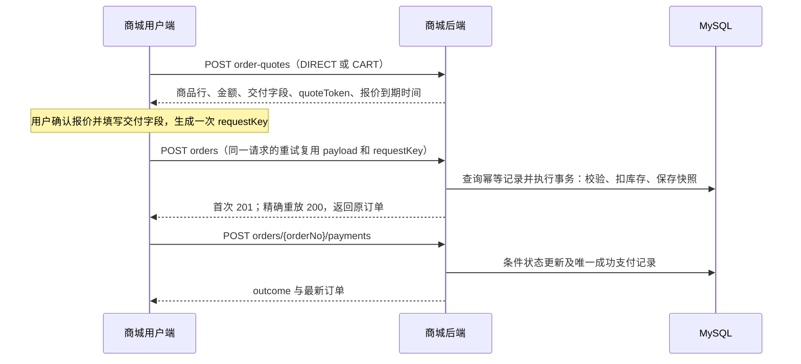
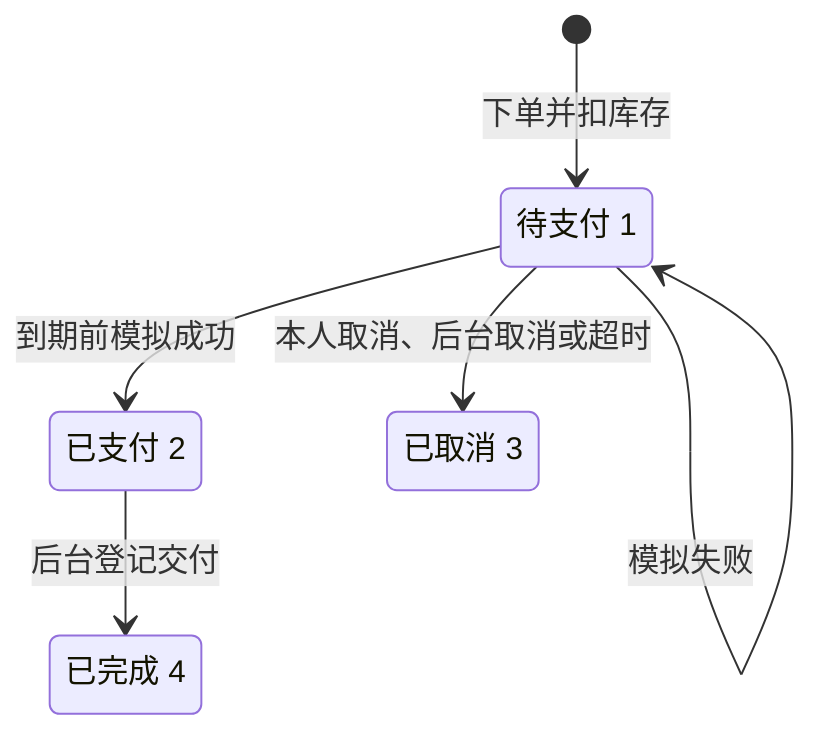

# 游戏道具商城接口设计

契约版本 **3.0.0**，数据库结构版本 **V007**，更新日期 **2026-10-23**。先完成数据库字段与关系设计，再由数据库定义请求/响应 DTO。本契约供后端、管理端和商城用户端并行开发使用。已有若依基础接口已导入；57 个商城业务操作已在 gameshop 实现；既有若依协议保持。真实验证与环境边界见 [后端实施记录](../../system/gc-shop/README.md)。

2.2.0 增加按游戏维护的区服及结算下拉选择，包含后台5个REST操作、报价 serverGroups、下单 serverIds 和历史交付快照；先读[游戏区服管理与结算](./游戏区服管理与结算.md)。3.0.0 改为若依原生认证，邮箱验证不启用。

按以下顺序阅读即可开始对接：

1. [数据库设计](../database/README.md) → [183 个字段的完整字典](../database/字段字典.md) → [可执行建表 SQL](../../system/sql/migrations/V001__create_mall_tables.sql)：15 张业务表和 1 张迁移版本表，包含类型、长度、可空、默认值、主外键、索引和 CHECK。
2. [用户端接口详细说明](./用户端接口详细说明.md)：23 个业务操作，逐一展开请求及所有嵌套返回字段、字段来源、业务规则、错误码和完整 JSON。
3. [管理端接口详细说明](./管理端接口详细说明.md)：34 个操作（含游戏区服），补充后台权限、版本校验、库存、交付及评价隐藏等动作。
4. [若依复用接口详细说明](./若依复用接口详细说明.md)：7 个若依操作（新增注册见统一认证），保留原登录/上传/菜单协议。
5. [接口字段与数据库映射](./字段与数据库映射.md)：区分直接存储、快照、关联、计算、Redis 和仅请求字段。
6. [全部接口 JSON 示例](./all-examples.json)：按 operationId 汇总 64 个操作及相应响应示例；图片下载用真实二进制类型标记，不能伪造 JSON。

- [接口索引](./接口索引.md)：64 个操作，包括 23 个用户端业务操作、34 个后台商城操作及 7 个若依操作，列出身份、权限、阶段和 DTO。
- [OpenAPI](./openapi.yaml)：请求、响应、必填字段、取值范围、错误码和示例的字段级契约，可导入支持 OpenAPI 的接口工具。
- [Mock 示例](./examples.json)：39 个用户端正常及异常场景，令牌和验证码均为虚构值。
- [用户端开发交接](../用户端开发交接.md)：页面映射、请求封装、Mock 范围与协作边界。

[REST 2.0 路径迁移说明](./REST迁移说明.md)列出与上一版所有路径/HTTP 方法差异；前端必须同步更新，不能继续使用旧 sessions、order-quotes 或后台 /list 地址。

下文固定通用业务语义；详细说明与 OpenAPI 的类型、必填项和示例保持一致。调整数据库、路径、字段、枚举、认证方式或状态机时必须同步 SQL/字段字典、详细接口、OpenAPI、示例和交接说明，不允许两端各自变更。

2.0.0 在原有路径和响应形状基础上补齐数据库设计、字段来源和逐接口完整示例；本版包含 REST 路径迁移和 gameshop 实现。示例实体与 [D001 演示数据](../../system/sql/demo/D001__mall_demo.sql) 对齐：商品 1001 当前 stock=8/sales=5，会员 2001 可评价的已完成明细为 50031。静态 JSON 使用固定示例时钟；SQL 的时间相对执行时钟平移。场景彼此独立，不能当成从头依次执行的录制结果。

## 1 接口地址与实现状态

| 调用方 | 浏览器请求 | 后端实际路径 | 认证 |
| --- | --- | --- | --- |
| 商城公开浏览 | `/api/mall/home`、`/api/mall/props` 等 | 原样保留 `/api/mall` | 匿名，调用方不附加会员令牌 |
| 商城个人及交易 | `/api/mall/me`、`/api/mall/orders` 等 | 原样保留 `/api/mall` | 若依统一 Bearer 令牌 |
| 管理端商城模块 | `/admin-api/mall/props` 等 | `/mall/props` | 若依统一令牌、后台访问资格和 `mall:*` 权限 |
| 管理端已有功能 | `/admin-api/login`、`/admin-api/getInfo` 等 | `/login`、`/getInfo` 等 | 若依原接口约定 |

本机后端 8080、管理端 5174；商城用户端 5173。商城 Vite 与部署代理均保留 `/api/mall`，不能像后台 `/admin-api` 那样去掉前缀。新图片路径也在 `/api/mall/media/**` 下，用户端不依赖后台上传接口。

OpenAPI 路径全部是**后端实际路径**。每个操作的 `x-implementation-status` 为 `planned` 或 `implemented`；57 个商城操作及 7 个若依操作为 implemented。`x-stage` 表示计划实现阶段，不代表该阶段已验收。

## 2 通用请求与响应

JSON 使用 UTF-8、camelCase。JSON 请求使用 `Content-Type: application/json`，上传使用真实 `multipart/form-data`。新商城写 DTO 使用允许字段列表，未知字段返回 400，禁止绑定 `memberId`、`role`、`passwordHash`、`sales` 等不可写属性；少量后台查询可以按 OpenAPI 显式接收 `memberId`。

通用封装示意（仅说明外壳；完整实体及嵌套字段见上方逐接口详细说明）：

```json
{"code":200,"msg":"操作成功","data":{"propId":"1001","price":"49.90"}}
```

成功分页响应：

```json
{"code":200,"msg":"查询成功","rows":[],"total":0}
```

无返回内容的成功操作也返回 HTTP 200 和 `{"code":200,"msg":"操作成功","data":null}`，不使用 204。新建资源首次成功用 HTTP 201，**成功响应体中的 code 均为整数 200**。列表为空是真实成功，网络失败不能伪装为 `rows:[]`。

新商城错误响应：

```json
{
  "code": 409,
  "msg": "库存不足，请调整购买数量。",
  "errorCode": "MALL_STOCK_INSUFFICIENT",
  "data": {
    "items": [{"propId":"1001","cartItemId":"4001","reason":"OUT_OF_STOCK","availableStock":1,"currentUnitPrice":"49.90"}]
  }
}
```

错误时 HTTP 状态与 body.code 一致；400 参数或验证码错误、405 方法不支持、406 响应类型不支持、401 无效身份、403 后台无权限、404 不存在/非本人、409 业务冲突、413 文件过大、415 图片类型不支持、429 限流、500 内部错误、503 邮箱功能关闭或邮件通道不可用。`msg` 用于展示，前端逻辑按 `errorCode` 分支；完整登记表见接口索引。`data` 可为 null；非空时仅使用 `ErrorDetails` 已定义的字段。字段错误放 `fieldErrors`，结算逐项问题放 `items`。

已有若依接口仍可能 HTTP 200 携带 body.code=401/500，两端请求层均需兼容。两端登录令牌均位于顶层 `token`，认证接口不能按商城业务的 `data` 解包。新增商城无内容响应需显式保留 `data:null`，不能直接假设上游 `AjaxResult.success()` 自动包含该键。

### 2.1 字段类型和分页

| 字段类别 | 固定约定 |
| --- | --- |
| 新业务 ID | 十进制字符串，范围 1–9223372036854775807；路径参数、请求和响应保持一致，不转 Number |
| 金额 | 人民币两位小数字符串，例如 `"0.00"`、`"49.90"`；最大 `"9999999999.99"`；商品售价必须大于零 |
| 数量与统计 | 数量、库存、页码、total、评分等用数值，不把 ID 规则套到所有数值上 |
| 时间 | ISO 8601，携带 `+08:00`，例如 `2026-10-22T20:00:00+08:00`；未发生的时间返回 null |
| 缺失和清空 | 请求中的可选字段按 DTO 规则省略；清空可空字段传 null，不传空字符串；响应必填但无值的字段返回 null |
| 分页 | `pageNum` 默认 1，1–100000；`pageSize` 默认 10，1–50；越界末页返回 rows=[] 和真实 total |
| 默认排序 | 用户订单/评价和后台列表按创建时间降序、相应 ID 降序；分类/轮播按 sort 升序、ID 升序 |

商品列表允许 `keyword/categoryId/minPrice/maxPrice/sort`；`sort` 只有 `sales_desc/price_asc/price_desc/on_sale_desc`，价格相同时按 propId 降序。金额筛选值也用两位小数字符串，minPrice 不大于 maxPrice。后台按 OpenAPI 指定过滤字段；`createdFrom` 含下界、`createdTo` 不含上界，两者都是带偏移的时间。不提供原始 SQL 排序、任意字段筛选或任意状态覆盖。

### 2.2 状态字典

| 类型 | 值 |
| --- | --- |
| 商品 | `"0"` 下架，`"1"` 上架 |
| 分类/轮播 | `"0"` 停用，`"1"` 启用 |
| 会员 | `"0"` 正常，`"1"` 禁用；注意与商品状态含义不同 |
| 订单 | `"1"` 待支付，`"2"` 已支付，`"3"` 已取消，`"4"` 已完成 |
| 评价 | `VISIBLE` 可见，`HIDDEN` 已隐藏 |
| 购物车可用性 | `AVAILABLE/OUT_OF_STOCK/OFF_SHELF/CATEGORY_DISABLED/DELETED/LIMIT_EXCEEDED` |
| 模拟支付 | 请求 result 为 `SUCCESS/FAIL`；响应 outcome 为 `SUCCESS/FAILED` |

状态值均按上述类型严格比较，不使用真假值判断，也不在界面自行拼装未定义的订单状态。

## 3 统一账号认证与商城资料

当前契约 **3.0.0 / V007**。完整路径、字段、示例和权限规则见 [若依统一认证](./若依统一认证.md)。登录、注册、验证码、退出直接使用若依接口；旧商城认证端点已移除。普通角色 common 仅能操作用户端，后台链要求管理权限。

商城令牌只在 Pinia 内存保存，刷新需重新登录；若依 Redis 会话滑动过期。密码变更、禁用、删除账号会使旧会话失效。资料、密码、头像仍使用 `/api/mall/me` 系列接口，基础账号资料与密码以 sys_user 为准。

## 4 门户 商品和图片

首页 `Home` 包含 banners（最多 10）、hotCategories（最多 8）、hotProps（最多 12）及 serverTime。分类为单层，热门分类来自人工 recommended 标记；热销依成功支付销量降序，未支付订单不计销量。所有首页集合只包含当前允许公开展示的数据。

`PropSummary` 供列表和首页使用，`PropDetail` 增加 images、detailHtml、specs、deliveryFields、reviewCount、averageScore。缺货商品仍可查看，stock=0/canPurchase=false；下架、删除或分类停用的公开详情统一 404。公开评价只含展示昵称、头像、评分、纯文本内容和时间，不暴露邮箱、会员账号、订单号或交付信息。

规格 `specs:[{name,value}]` 仅展示，不选择 SKU、不按规格改变价格。价格、库存、销量由服务器返回；originalPrice 为 null 或不小于 price。图片 1–10 张、URL 不重复，coverUrl 必须包含在 images 中；规格最多 20 项且名称不重复。`deliveryFields` 是当前商品要求的交付字段，至少一项。

新图片统一返回同源路径 `/api/mall/media/{32位小写十六进制文件名}.{png|jpg|webp}`。会员头像和后台图片上传均需校验扩展名、实际内容、像素和大小并重新编码；分别上限 2 MiB/5 MiB，最大 4096×4096。公开图片 GET 返回二进制，不包 JSON。不得把会员交付信息、证件等私密文件放入公开目录。

详情富文本允许 `p/br/strong/em/ul/ol/li/h2/h3/blockquote/img/a`；img 仅允许本系统图片路径，a 仅允许内部商城路径，移除事件属性、style、script、iframe、SVG 和外站/脚本链接。后端执行允许列表清洗，用户端只按同一规则渲染；评价始终按纯文本渲染。

## 5 购物车

`GET /api/mall/cart/items` 返回完整 `Cart`，最多 100 种商品，不分页。条目按最近修改倒序；每行包含 cartItemId、商品展示、当前单价、quantity、checked、stock、availability、canCheckout、subtotal。商品失效时保留该行以供删除，不能把整次失败当空购物车。

| 写操作 | 固定语义 |
| --- | --- |
| POST items | quantity 是新增量，同商品合并并设 checked=true；总数量不得超过 99 和可用库存 |
| PUT items/{cartItemId} | quantity 是绝对值，并同时提交 checked；减少数量或仅取消勾选时可保留失效行，增加数量时严格校验可售/库存 |
| DELETE items/{cartItemId} | 仅按当前会员归属删除；不存在/已删除/他人条目均不泄露存在性，返回本人当前 Cart |
| PUT cart/selection | 显式传 cartItemIds 和 checked；全部校验归属，任一无效则整批不改 |

以上成功写操作均返回最新 Cart，前端整体替换以同步金额和状态。POST 加购不是幂等动作，超时应先重新读取购物车，不能直接无条件重发；数量修改 PUT 可以复用同一绝对值重试。

summary.totalItemCount 是不同商品行数，totalQuantity 是所有行的数量总和；selectedItemCount、selectedQuantity、selectedAmount **只统计 checked=true 且 canCheckout=true** 的行；invalidItemCount 是所有 canCheckout=false 的行数。前端应提示勾选但无法结算的条目，并以接口返回的 selectedAmount 展示合计。

## 6 结算与下单



### 6.1 预览

立即购买：

```json
{"source":"DIRECT","items":[{"propId":"1001","quantity":2}]}
```

购物车结算：

```json
{"source":"CART","cartItemIds":["4001","4002"]}
```

DIRECT 首版只含一个商品；CART 最多 50 行，按显式选择的本人 cartItemIds 结算，不能在后端偷偷改为“所有 checked 项”。每行数量 1–99，重复 ID/重复行拒绝。预览任一行无效则整次失败，在 ErrorDetails.items 中说明，不静默删除或降量。

预览返回 OrderPreview：items 为服务端当前价格/数量，totalAmount 为其和，currency=CNY，deliveryFields 为所选商品要求字段的并集。quoteToken 不透明，5 分钟有效并绑定当前会员、来源、商品/数量/单价和购物车快照；预览**不扣库存**。前端用 quoteExpiresAt 与 serverTime 决定是否需要刷新报价，不能解码或伪造凭据。

### 6.2 创建订单与幂等

```json
{
  "requestKey":"3153d0a1-22df-4480-a34d-0c86d95d045b",
  "quoteToken":"mock-quote-token-0001",
  "deliveryInfo":{"gameAccount":"demo_game_account","serverName":"一区","roleName":"星海旅人"},
  "remark":"请按角色名核对后交付。"
}
```

商品 ID、数量、金额取自后端报价凭据，不从创建请求另接价格/数量/状态。交付字段最多为 gameAccount/serverName/roleName，按 deliveryFields 必填；字段首尾 trim，长度 1–100，未要求字段可省略或为 null；禁止收集游戏密码。remark 最多 200 字符，空白归为 null。订单总额须仍在金额字段容量内。

requestKey 为 UUID，唯一范围是当前会员，随订单事实保留，不按短缓存 TTL 丢失。请求摘要以 quoteToken、规范化后的 deliveryInfo（三个键缺省视作 null）和 remark 计算；相同键与相同内容返回原单，改变任何内容返回 `MALL_IDEMPOTENCY_CONFLICT`。修改报价或交付信息意味着新的用户确认，生成新键。

服务端先查询已有幂等记录，再检查报价有效性；已创建成功的原请求即使随后报价过期、购物车被清理，也能精确重放取回原单。首次 HTTP 201，`data={order,replayed:false}`；重放 HTTP 200，`replayed:true`。前端请求超时后保留原 payload/key，再尝试相同请求；不得把超时直接当失败并换键下单。若整页刷新导致内存确认单丢失，先让用户到“我的订单”核对，不自动发起一张新订单；本版不承诺跨刷新恢复未完成的请求体。

新建事务重新验证商品/分类状态、报价、购物车数量及库存；按固定锁顺序处理所有明细，任何失败整单回滚。下单即扣可售库存，保存名称、图片、规格、单价快照，只清理成功结算的购物车行。价格改变返回 `MALL_QUOTE_CHANGED`，数量/选择快照变化返回 `MALL_CART_CHANGED`，报价无效/过期返回 `MALL_QUOTE_EXPIRED`；前端重新预览，并要求用户重新确认，不能静默按新价格继续。

## 7 订单状态 支付与交付



订单列表与详情返回快照及按钮能力。`canPay/canCancel` 由后端计算；评价按钮以**每条明细**的 canReview 为准。没有“已过期”数值状态：订单过期后任务尚未处理时，可能仍是 status="1"，但 canPay=false。倒计时以 expiresAt 和 serverTime 校正，不以浏览器时钟独自裁决；归零后刷新详情并等待关单，不能假装本地已取消。

| 动作 | 结果与重复调用 |
| --- | --- |
| 模拟 SUCCESS | 仅未到期 1→2；写唯一成功支付记录，增加销量，不再次扣库存；同订单重复 SUCCESS 在 2/4 读取原支付结果 |
| 模拟 FAIL | 待支付单保持 1；HTTP 200、outcome=FAILED、paymentNo=null，表示模拟失败结果，界面不能显示支付成功 |
| 已支付单请求 FAIL | 409 状态冲突，不把已支付订单改回待支付 |
| 本人/后台取消 | 仅 1→3；状态更新获胜的事务回补一次；已取消重复取消返回原结果；2/4 拒绝 |
| 超时关闭 | 创建后 30 分钟，每分钟扫描；与取消使用同一服务，可补扫，不能重复回补 |
| 后台完成 | 仅 2→4，deliveryNote 必填；交付说明与状态同事务；相同说明重复调用读原结果，不同说明拒绝覆盖 |

到期后即使任务尚未改状态，支付也返回 `MALL_ORDER_EXPIRED`。支付/取消/超时并发使用条件状态更新，只能有一个合法结果。网络失败与模拟 outcome=FAILED 要区分；所有支付、取消冲突后应读取最新订单再展示操作。

已有待支付单在期限内允许按快照支付，即使商品后来改价、下架、软删除或分类停用。历史快照不会随商品改名改价改变。首版不支持付款后取消、退款或真实扣款；页面应明确“模拟支付，不发生真实扣款”。不提供任意改订单状态或物理删除交易记录的接口。

## 8 评价

创建评价只接受 orderItemId、score（1–5 整数）和 content（5–1000 字符纯文本）。服务端确认明细属于当前会员且订单为 4，每条明细仅一次，数据库唯一约束防并发重复。不是本人/不存在统一 404，状态不满足返回 409，已评价返回 `MALL_REVIEW_ALREADY_EXISTS`。

`GET /api/mall/me/reviews` 返回本人全部评价，包括 HIDDEN 和 hideReason；公开商品评价仅 VISIBLE，reviewCount/averageScore 也只统计 VISIBLE。后台“移除评价”通过带原因的 hide 动作实现，不物理删除、不开放首版恢复/修改接口，也不释放这条订单明细的评价额度。

## 9 后台操作与权限

后台新增接口以 `AdminBearer` 鉴权，再检查接口索引中的 `x-permission`。前端菜单和按钮只能改善体验，后端仍需方法级权限与审计；不把“已登录后台”当成全部商城权限。既有 `/system/**` 等若依接口保持原样。

| 范围 | 写入规则 |
| --- | --- |
| 分类/轮播 | POST 创建，PUT 完整更新可写字段并携带 version；分类名 trim 后按数据库统一排序规则唯一；分类有关联未删除商品时不可删除 |
| 商品 | POST 时接受 initialStock 并留初始库存日志；PUT 拒绝 stock/sales/initialStock；上下架独立动作，使用 version 防覆盖 |
| 商品图片 | 使用 `POST /mall/media/images` 和 `mall:media:upload`，不把已有通用上传的校验能力当成已实现的商城安全能力 |
| 库存 | delta 是非零增减量，不是绝对库存；原子更新、范围校验、追加日志；按 propId+ADMIN_ADJUST+requestKey 幂等，摘要还包含操作者、delta 和 reason |
| 会员 | 查询脱敏邮箱/手机号；启停必须记录原因，禁用立即撤销旧会话，启用不能恢复旧令牌 |
| 订单 | 按状态机取消/完成，禁止通用 PUT 覆盖 status 或删除订单 |
| 评价/库存流水 | 评价只能隐藏并留原因；库存流水只读、不可删除 |

分类、轮播和商品的普通 PUT 均为**完整可写字段更新**。其中可空字段清空传 null，数组清空传 []（但图片至少一张）；必须携带读取到的 version，冲突后重新读取并让用户确认，不自动覆盖。库存变动也可能递增商品 version；商品编辑界面不得把旧库存作为普通字段送回。

取消订单和回补库存必须仍能引用软删除商品。后台删除不是回避迁移、库存一致性或历史记录约束的途径。列表、详情、写入、库存调整和交付权限按接口索引分别授予。

## 10 开发与契约验收

后端按 S1 会员、S2 商品、S3 购物车/预览、S4 订单支付、S5 交付评价落地；公共媒体随头像在 S1 引入。前端可使用真实接口，也可通过显式 Mock 模式独立开发；两种模式保留相同 DTO。

接口落地时，按操作更新实现状态并记录真实联调结果；implemented 表示已有代码；验收覆盖和未验证环境单独记录，不能把该标签当成所有部署环境均通过。字段增加可作为兼容变化，但调用方必须忽略不认识的响应字段；删除/重命名/改类型/改枚举或语义要先同步两端并递增契约主版本。

2026-10-22 校验结果：OpenAPI 3.0.3 结构与引用通过；64 个 operationId 唯一，认证和权限标记完整；113 个 schema 对应的组件、逐接口和场景样例共 745 项数据校验通过；39 个 Mock 场景金额与状态关系一致；7 项非法请求检查通过，包含多余角色字段、数字 ID、非法数量、重复购物车项、前端传入订单总价、普通商品编辑夹带库存及零库存调整。

2.0.0 补充校验：541 个 DTO 属性的字段来源均已检查，所有 `mall_表.列` 引用真实存在；完整示例文件及路径、查询、请求/响应共 667 项额外校验通过；三个详细说明中的 593 段 JSON 均可解析，覆盖全部 69 个操作及各操作登记的错误码，请求长度不超过对应存储容量。结果见[接口校验记录](./validation-result.json)。数据库另有[独立执行记录](../database/validation-result.json)，验证库已清理；应用库已备份并应用 V001–V003，没有导入 D001。

复核 OpenAPI 结构时，可在装有 `openapi-spec-validator==0.7.2` 的独立工具环境、从仓库根目录运行 `python -m openapi_spec_validator docs/api/openapi.yaml`。校验只覆盖**文档契约**，不替代后端身份、并发和真实数据库测试，实际结果见后端实施记录。规范依据：[OpenAPI 3.0.3](https://spec.openapis.org/oas/v3.0.3)。

2026-10-22：契约 2.1.0 增加邮箱验证配置及图形码注册分支，默认关闭；既有邮箱成功示例以开关开启为前提，注册主示例展示关闭模式，接口路径和数据库结构保持。
