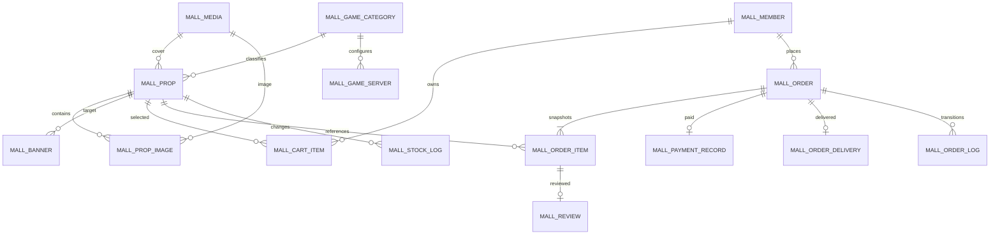

# 商城数据库设计

结构版本 **V007**（V001基线＋V002–V007增量），对应接口契约 **3.0.0**，更新日期 **2026-10-23**。本设计在现有若依数据库中新增 **15 张业务表和 1 张迁移版本表，共 183 个字段**。所有字段的类型、长度、可空性、默认值、索引、外键、CHECK 及接口映射均已展开。

1. [完整字段字典](./字段字典.md)：逐表逐字段阅读入口。
2. [V001 建表 SQL](../../system/sql/migrations/V001__create_mall_tables.sql)：实际可执行结构，不含删库、删表或改写 sys_*。
3. [可选演示数据 SQL](../../system/sql/demo/D001__mall_demo.sql)：2 位会员、1 个商品、5 笔场景订单（覆盖 4 种状态、可评价与已评价）、库存流水和评价；账号和场景见 [SQL 说明](../../system/sql/README.md)。
4. [数据库校验结果](./validation-result.json)：隔离 MySQL 中真实执行的 DDL、数据与约束检查。
5. [Redis 临时数据设计](./Redis数据设计.md)：会话、验证码、报价、限流及其 TTL。
6. [接口设计入口](../api/README.md)：逐接口参数、字段来源及完整 JSON。

当前增量见 [V006 SQL](../../system/sql/migrations/V006__game_servers.sql)；区服交互、完整JSON和迁移兼容规则见[游戏区服管理与结算](../api/游戏区服管理与结算.md)。原 validation-result.json 是V001基线验证，V006真实迁移记录在[game-servers-migration.json](../validation/game-servers-migration.json)。

## 1 业务表与职责

| 表 | 作用 | 关键关系与规则 |
| --- | --- | --- |
| mall_media | 受控公开图片及文件元数据 | 仅存文件元数据和相对存储路径，不把二进制存进 MySQL |
| mall_member | 商城业务档案 | sys_user_id 唯一关联若依账号，保留 member_id 交易归属 |
| mall_game_category | 单层游戏分类 | 软删除，未删除分类名称唯一；图标关联媒体 |
| mall_game_server | 按游戏维护区服 | 分类外键、名称唯一、乐观锁、启停及软删除；订单另存名称快照 |
| mall_prop | 商品、价格、当前可售库存及销量 | 单商品单库存；普通编辑不得覆盖库存、销量 |
| mall_prop_image | 商品多图关联 | 同商品同媒体唯一；封面必须在图片集合内 |
| mall_banner | 首页内部商品轮播 | 仅跳内部商品，目标不可公开浏览时隐藏轮播 |
| mall_cart_item | 会员当前购物车 | 同会员同商品唯一；价格和合计实时计算 |
| mall_order | 订单归属、金额、状态、交付信息快照与幂等凭据 | 同会员同 request_key 唯一；不物理删除 |
| mall_order_item | 下单时商品、图片、规格、单价和数量快照 | 同订单同商品一行；subtotal 是数据库生成列 |
| mall_payment_record | 唯一成功模拟支付事实 | 一单至多一条，失败不写成功事实 |
| mall_order_delivery | 唯一管理员交付事实 | 一单至多一次完成；说明向购买会员公开 |
| mall_order_log | 只追加的订单状态流水 | 仅 null→1、1→2/3、2→4；失败模拟不新增状态事件 |
| mall_stock_log | 库存流水与人工调整幂等记录 | 同商品、业务类型、业务键唯一；校验前后库存算术 |
| mall_review | 本人已完成订单明细评价 | 每条明细一条，隐藏也不释放额度；复合外键校验归属 |
| mall_schema_history | 已完成迁移版本记录 | V001 完整执行后写入，不是业务表 |

## 2 关系设计



会员头像、分类图标、商品封面、商品图片和轮播图片使用媒体 ID 物理外键，DTO 通过媒体 access_path 转为 URL。订单封面保留 URL 快照，不随商品图片替换改变。媒体不开放删除接口，历史快照所需文件保留。

所有商城内部物理外键均为 RESTRICT，不级联删除交易数据。后台操作者存在多态引用：ADMIN 对应 sys_user，MEMBER 对应 mall_member，SYSTEM 的 operator_id 为 null。此类字段明确使用**服务层逻辑关联**并保存账号快照，不能谎称同一个 operator_id 有两个物理外键；也不为审计字段新增阻塞若依账号管理的外键。

评价同时建立 `(order_id,member_id)`→订单归属和 `(order_item_id,order_id,prop_id)`→明细身份的复合外键，防止将他人订单或不同商品明细混接。订单是否完成仍由事务服务检查，不能用 CHECK 表达跨表状态规则。

## 3 统一字段规则

| 类型 | 数据库规则 | 接口规则 |
| --- | --- | --- |
| 主键与外键 | 正数 BIGINT，Java Long，不用 unsigned 扩大到 Java 不支持的范围 | JSON 和路径参数使用字符串，不能转为 JS Number |
| 金额 | DECIMAL(12,2)，最大 9999999999.99，售价/支付金额大于 0 | 两位小数字符串，不返回浮点金额 |
| 数量 | 购买数量 1–99，每次最多 50 种；订单数量合计最多 4950 | 整数，不能由前端控制最终结算金额 |
| 可售库存 | INT，0–1000000000；销量为非负 INT | stock/sales 为数值；普通商品编辑不接收它们 |
| 时间 | DATETIME(3)，服务、JDBC 和数据库会话使用 Asia/Shanghai/+08:00 | 带 +08:00 的 ISO 8601；无事件时间为 null |
| 状态 | CHAR/VARCHAR 配合显式 CHECK，不依赖 magic number | 商品/分类 0 停用或下架、1 启用或上架；会员 0 正常、1 禁用；订单 1/2/3/4 |
| 版本 | INT 从 0 递增；更新时必须带旧版本条件 | 后台 version 为只读后再提交的并发凭据 |
| JSON | 规格和交付字段为数组；订单交付信息为对象；DB 校验外层结构 | 嵌套字段名、枚举、数量、长度和私密字段允许列表由 DTO/Service 校验 |
| 删除 | 分类、商品、轮播 del_flag：0 正常、2 删除；评价用 HIDDEN | 不把删除态记录作为新订单可购买数据，不删除订单/支付/库存/交付事实 |

商品富文本最多 20000 **字符**，采用 MEDIUMTEXT，避免 TEXT 的字节容量无法容纳 20000 个 utf8mb4 字符。密码只存 60 字符的 BCrypt；会员密码输入限制 8–64 个 ASCII 非空格可打印字符，至少字母和数字，使用 cost=12，避免输入截断。

用户名和邮箱先在服务层 trim 并转小写；唯一索引基于规范化值。分类名称按 utf8mb4_unicode_ci 比较。分类 active_name 是生成列，软删除后生成 null，允许重建同名分类且不破坏旧商品历史引用。

## 4 哪些是存储字段 哪些是计算字段

| 返回字段 | 来源和算法 |
| --- | --- |
| avatarUrl/iconUrl/coverUrl/imageUrl | 关联媒体 access_path，不拼接磁盘路径 |
| categoryName | 实时分类名称；订单明细不依赖它决定历史金额 |
| OrderItem.propName/coverUrl/specs/unitPrice | mall_order_item 的下单快照，不读商品当前展示值覆盖历史 |
| canPurchase | 商品未删除、上架、分类未删除且启用、stock>0 |
| availability/canCheckout | 购物车关联商品/分类状态、当前库存与该行数量计算 |
| CartItem.subtotal | 当前商品单价×购物车数量；不可计算或失效时按契约返回 null |
| Cart.summary | 对当前会员购物车汇总；selected* 只计 checked=true 且 canCheckout=true |
| OrderItem.subtotal | 数据库 STORED 生成列 unit_price×quantity，写 Mapper 不传此列 |
| canPay | status=1 且服务器当前时间早于 expire_time；不能只判断数值状态 |
| canCancel | status=1；过期但尚待任务关闭仍可取消 |
| canReview/reviewId | 本人订单 status=4，按明细关联评价；有隐藏评价也算已评价 |
| reviewCount/averageScore | 只聚合 VISIBLE 评价；无评价时数量为 0、均分为 0 |
| emailMasked/phoneMasked | 从会员联系方式派生，后台不直接返回完整原值 |
| serverTime | 服务端本次响应时钟，不新增数据库列 |
| quoteToken | Redis 中短期报价标识，不作为数据库价格字段或永久登录凭据 |
| replayed/outcome | 本次请求处理结果，不是订单表状态字段 |

每个详细接口字段表进一步列出具体 `表.字段` 或“计算/Redis/上下文”来源。不存在为了迎合 JSON 而虚构同名数据库列的情况。

## 5 事务与约束责任

下单事务包含订单、明细、库存扣减、库存流水、初始状态流水以及本次购物车行清理。顺序为先检查幂等结果，再锁定分类/商品并检查报价、归属和库存，保存快照后提交；任一失败整单回滚。金额汇总、媒体归属、封面在图片集合中、分类启用等跨行规则由 Service 维护，物理 FK/CHECK 是第二层保障。

支付事务只允许未到期的 1→2，新增唯一成功支付记录并累计销量，库存不再扣减。取消、超时关闭使用同一服务，只有获得 1→3 的事务能回补一次库存。完成交付将 2→4、交付事实和状态流水同事务写入。状态重复事件和支付/交付重复事实还有唯一索引兜底。

库存流水的 change_qty/before_stock/after_stock 校验算术关系；人工调整以 `prop_id + ADMIN_ADJUST + requestKey` 唯一，request_hash 包含规范化 propId、操作者 ID、delta、reason。重放返回原日志，不伪装成当前库存。

条件扣减示意（须置于完整业务事务中）：

```sql
UPDATE mall_prop
SET stock = stock - :quantity, version = version + 1
WHERE prop_id = :propId AND stock >= :quantity
  AND status = '1' AND del_flag = '0';
-- 必须检查受影响行数=1；分类状态检查需与该操作持有一致的锁。
```

普通编辑使用 version 条件，修改价格/展示字段也不得携带旧库存覆盖。锁顺序为分类 ID 升序→商品 ID 升序；支付/取消先锁订单，再处理商品。事务竞争、死锁有限重试、状态边界及错误码在接口文档中定义。

## 6 索引与查询

- 商品有分类/状态/上架时间、售价、销量索引；keyword 首版使用受控 LIKE，不声称前置通配符可走普通 B-tree 范围索引。
- 会员订单使用 member_id+创建时间及 member_id+status+创建时间索引；超时扫描使用 status+expire_time+order_id。
- 公开评价使用 prop_id+status+create_time+review_id；本人评价使用 member_id+create_time+review_id。
- 购物车有 member_id+prop_id 唯一键和 member_id+update_time 排序索引；库存按商品、业务类型与时间查询。
- 唯一键同时承担幂等与防重复事实；复合外键所需引用列也建立明确唯一索引，不依赖非唯一被引用键。

## 7 与若依原表衔接

`sys_user/sys_role/sys_menu/sys_user_role/sys_role_menu` 继续负责后台账号、RBAC 与商城操作权限。`sys_oper_log` 记录后台写操作，敏感密码和令牌必须排除；会员状态表只保存最近原因，完整启停历史由审计保留。`sys_job/sys_job_log` 和既有 Quartz 基础设施继续承载任务，关单业务扫描的是 mall_order，不靠 Quartz 表表示交易状态。

V001 不增加新的管理员账号，不给会员写 sys_user，不覆盖角色菜单，不改原始若依 SQL。商城菜单/权限数据需随后台页面实现另给增量脚本；不能因为有权限字符串就宣称后台页面已接入。

## 8 执行与验证边界

设计阶段曾仅在隔离库执行 V001/D001，原始约束结果保留在 validation-result.json。后端实施阶段已先备份应用库，再增量执行 V001–V003；当前 gc_system 共 46 表，其中 15 张 mall_*，没有导入 D001。V002 注册 Quartz 关单任务，V003 注册后台七页菜单、路由及按钮权限。真实业务/浏览器验证另在隔离库执行并清理，结果见[验收记录](../后端与后台验收.md)。

新部署顺序是若依两份基线 SQL→V001→V002→V003→V004→V005→可选 D001。V004 已在应用库备份后执行，只精确替换默认展示；V005 再次备份后移除部门/岗位、系统监控、系统工具及全部后代的菜单和角色关联。两者均不改变结构、账号归属或交易记录，重复执行已验证；部门/岗位基础数据和关单任务保留。已有若依应用库先备份，然后仅执行新的迁移；不要重跑包含 DROP TABLE 的上游基线。MySQL 客户端应开启 `--abort-source-on-error`，任何语句失败立即停止，不因 DDL 隐式提交而盲目重跑或删库重建。

验证包括实际创建 15 表、169 字段可空性核对、演示订单总额/库存/销量一致性，以及唯一键、外键、CHECK、条件扣库存和版本条件 SQL 共 17 项检查。实际引擎为 MySQL 8.3.0；目标语法要求至少 8.0.16，目标 8.0 部署仍需按同脚本复核。

演示 SQL 的媒体是占位元数据，不含真实图片文件。接口 JSON 中的日期固定，SQL 按执行时刻平移；支付、取消、调整库存、发表评价等示例代表独立场景的动作结果，不能当成同一时刻的全库快照。

MySQL 对 CHECK 的强制执行从 8.0.16 开始，跨表状态仍需事务服务处理。[MySQL CHECK 约束说明](https://dev.mysql.com/doc/refman/8.0/en/create-table-check-constraints.html)；物理关联和生成列规则分别参考 [外键说明](https://dev.mysql.com/doc/refman/8.0/en/create-table-foreign-keys.html) 和 [生成列说明](https://dev.mysql.com/doc/refman/8.0/en/create-table-generated-columns.html)。

## V007 统一身份

新增 mall_member.sys_user_id 外键/唯一索引；旧会员密码迁至 sys_user，原密码列置空，邮箱可空且不再唯一。sys_user 增加用户名唯一索引并扩展联系方式长度。详细增量字段、约束和账号冲突处理见 [若依统一认证](../api/若依统一认证.md) 与 [V007 SQL](../../system/sql/migrations/V007__ruoyi_storefront_identity.sql)。
