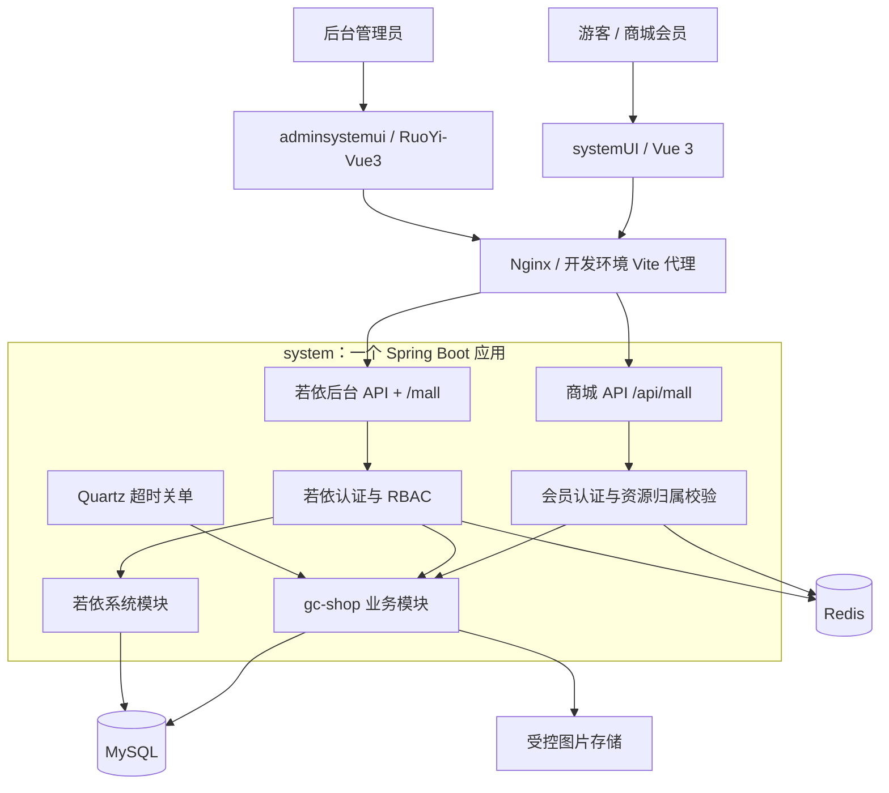
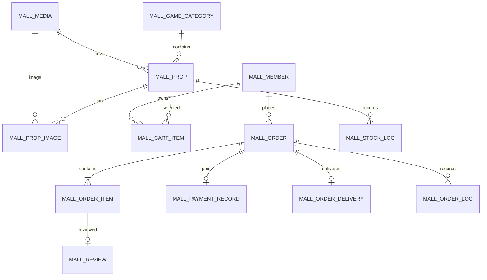
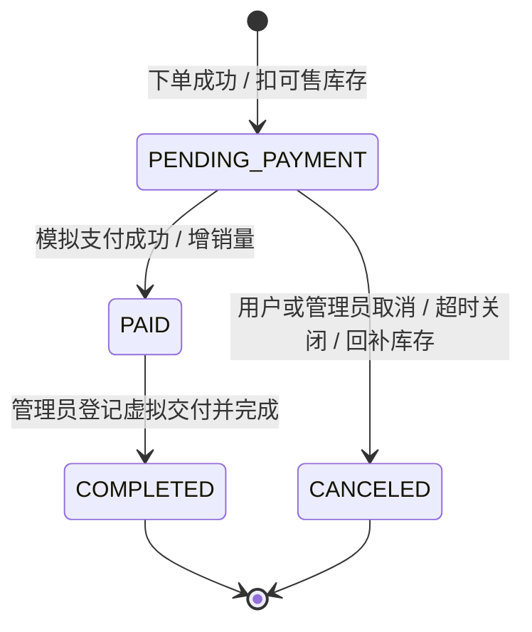

# 游戏道具商城：开发流程与架构设计

> 更新日期：2026-10-22。本文是开发基线，描述计划与设计，不代表功能已经实现。
> 需求来源：[开题(2).doc](./开题(2).doc)；长期协作约束与项目记忆见根目录 [AGENTS.md](../AGENTS.md)。

## 1. 项目现状与目标

当前已导入官方若依 `springboot3` 后端至 `system`、官方 Vue3 管理端至 `adminsystemui`，配置环境文件、固定构建工具和开发代理；商城用户端 `systemUI` 仍只有 `.gitkeep`。本次目录名称按用户明确指令调整，替代原 `gsSystem` / `gsSystemAdminUI`。本机新建 `gc_system` 并导入 31 张若依基础表，后端编译打包、启动和验证码接口已验证；详细来源见 [上游源码记录](./上游源码记录.md)，其他最终结果见 [环境配置与验证](./环境配置与验证.md)。后续已实现 gameshop、会员独立安全链及七个后台页面，应用库共 46 表，当前验收见 docs/后端与后台验收.md。

本项目面向课程实践，建设一个自营的虚拟游戏道具商城，完成“管理员维护商品 → 用户浏览 → 加入购物车/立即购买 → 下单锁定库存 → 模拟支付 → 管理员确认交付 → 用户评价”的闭环。

第一版按两套独立前端、一个模块化单体后端、一套 MySQL 数据库实施。后台及后端基于官方 RuoYi-Vue 二次开发，商城前端独立使用 Vue 3。暂不引入微服务、消息队列、搜索引擎或分布式事务。

### 1.1 范围分级

- **首版必须实现**：原需求中的门户、道具、分类、会员、购物车、订单、模拟支付、评价及相应后台管理；找回密码需有可验证的身份校验流程。
- **支撑首版闭环**：轮播图配置、订单超时关闭、库存变更记录、操作日志、虚拟道具交付信息、最小部署与演示数据。
- **后续扩展**：真实支付、退款售后、优惠券、多商户、多规格 SKU、自动卡密发货、游戏 API 对接、WebSocket 库存推送、个性化推荐。

“实时库存”首版解释为详情和提交订单时从后端读取当前库存，以数据库扣减结果为准；不承诺浏览页面的数字持续推送刷新。

### 1.2 原文与实施基线的差异

| 原文描述 | 本项目采用的方案 | 原因与影响 |
| --- | --- | --- |
| 单个 `user` 表，通过 `role` 区分管理员/普通用户 | 若依 `sys_user` 统一账号，`mall_member` 关联业务档案 | 统一认证、按角色限制后台并校验交易归属 |
| 密码使用 MD5 | BCrypt 单向散列，复用适合的若依密码工具 | 不引入 MD5 密码存储 |
| 后端 MyBatis-Plus | 首版沿用若依原生 MyBatis + XML | 降低框架改造量；若课程明确要求 Plus，在 S0 调整并记录决策 |
| 自建 `Result<T>` | 沿用若依 `AjaxResult` / `TableDataInfo` 约定 | 两端统一适配，避免破坏后台现有协议 |
| 一个前端内用 `/admin` 和角色判断区分两端 | 两个独立 Vue 工程，后端分别鉴权 | 前端隐藏菜单无法替代后端权限控制 |
| 所有页面都要求登录、两端都用后台侧栏布局 | 商城浏览页公开，购买及个人页登录；后台沿用侧栏 | 属于门户体验的规划调整，不是已实现行为 |
| 道具规格、收货信息未展开 | 单商品单库存，规格为展示属性；收货信息为游戏账号/区服/角色名 | 首版无实体物流，也不收集游戏密码 |
| Node.js 18 | 拟采用 Node.js 24 LTS，并核验选定模板兼容性 | 原文环境较旧，初始化时锁定具体补丁版本 |

除用户已指定的三目录、若依和 Vue 外，本文的版本、交付方式、时限和业务规则属于可执行的默认设计，允许在对应阶段有依据地修订。

## 2. 功能清单与验收映射

| 编号 | 模块 | 用户端 | 管理端 | 首版验收重点 |
| --- | --- | --- | --- | --- |
| F01 | 门户 | 轮播、热销道具、热门分类 | 配置轮播、分类排序与推荐标记 | 未登录可看；隐藏内容不展示；热销按有效已支付销量排序 |
| F02 | 分类 | 分类入口、按分类筛选 | 新增、编辑、启停、排序、删除 | 有商品引用时禁止删除；停用分类下商品不可新购 |
| F03 | 道具检索 | 关键词、分类、价格区间、销量/上架时间排序、分页 | 条件查询道具 | 分页与排序由后端执行；公开接口只返回可展示商品 |
| F04 | 道具详情 | 封面、多图、图文、展示规格、当前库存、公开评价 | 新增、编辑、上下架、图片管理 | 非法价格/库存被拒绝；下架商品不能加入购物车或下单 |
| F05 | 账号 | 注册、登录、退出、找回密码 | 会员查询、禁用/启用 | 注册不能提交管理员角色；禁用和改密后旧会话失效 |
| F06 | 个人中心 | 昵称、头像、联系方式、修改密码 | 查看必要会员信息 | 不返回密码散列；身份从会话获取 |
| F07 | 购物车 | 添加、改数量、删除、勾选、批量结算 | 不开放任意修改会员购物车 | 同商品合并；失效商品可见但不可结算；服务端校验归属 |
| F08 | 确认订单 | 立即购买/购物车预览、游戏交付信息、金额展示 | 查看订单明细 | 预览不锁库存；提交时重新校验商品、价格与库存 |
| F09 | 订单 | 提交、列表、详情、取消、超时关闭展示 | 全量查询、待支付取消 | 不超卖；重复提交不产生重复订单；只能操作自己的订单 |
| F10 | 模拟支付 | 对待支付订单发起模拟成功/失败 | 查看支付记录 | 重复成功请求不重复计销量；失败仍待支付；无真实扣款 |
| F11 | 虚拟交付 | 查看支付状态、完成状态和交付说明 | 已支付订单登记交付并完成 | 完成需有交付记录；无任意状态下拉覆盖 |
| F12 | 评价 | 已完成订单评价、我的评价、商品评价列表 | 查询、删除违规评价并记录原因 | 每条订单明细最多一条评价；只允许购买者评价 |
| F13 | 库存 | 展示可售库存和不足提示 | 增减可售库存、查询变更记录 | 调整与下单并发时保持一致；撤单仅回补一次 |
| F14 | 系统支撑 | 登录过期、权限不足、空列表、错误重试提示 | 若依菜单/按钮权限、字典、日志、定时任务 | 权限校验在接口生效；关键写操作可追溯 |

### 2.1 页面规划

用户端至少 12 类页面：登录、注册、找回密码、首页、道具列表、道具详情、购物车、订单确认、模拟支付、我的订单、订单详情、个人中心（含资料/密码/我的评价子页）。

管理端保留若依登录与布局，新增道具、分类、轮播、会员、订单、评价、库存记录页面；角色、菜单、字典、操作日志和任务调度复用若依。用户端采用顶部导航和商城内容布局，个人中心使用侧栏；管理端使用侧栏、面包屑和表格表单布局。

## 3. 技术选型与版本策略

| 层次 | 拟用技术 | 实施约束 |
| --- | --- | --- |
| 后端基础 | 官方 RuoYi-Vue，`springboot3` 分支 | 选定后记录 commit SHA，禁止直接跟随浮动分支升级 |
| Java | JDK 17、Spring Boot 3.x、Maven | 具体依赖跟随选定若依基线，不单独强升 Spring Security 等组件 |
| 认证授权 | Spring Security、JWT、Redis、后台 RBAC | 两端复用若依认证；普通角色无后台权限 |
| 数据访问 | MyBatis、XML Mapper、若依分页组件 | 条件 SQL 扣库存；核心事务自行编写 |
| 数据库 | MySQL 8.0、InnoDB、utf8mb4 | 与原需求一致；S0 核验可用发行版及补丁；金额用 DECIMAL |
| 缓存与任务 | Redis、若依 Quartz | Redis 首先用于会话、验证码与限流；订单事实以 MySQL 为准 |
| 管理端 | 官方 RuoYi-Vue3、Vue 3、Vite、Element Plus、Pinia、Vue Router 4、Axios | 默认 JavaScript，沿用模板接口与菜单机制 |
| 用户端 | Vue 3、Vite、JavaScript、Pinia、Vue Router 4、Axios、Element Plus | 独立商城布局、独立请求封装和登录状态 |
| 工程工具 | Node.js 24.20.0、npm 11.19.0、Maven Wrapper / Maven 3.9.10 | 管理端已固定并保留 `package-lock.json`；商城工程初始化时沿用 |
| 运行部署 | Nginx + Spring Boot Jar + MySQL + Redis | 先跑通本地；Docker Compose 可作为部署补充 |
| 文件存储 | 本地受控上传目录 + 静态资源映射 | 封装存储接口；以后可替换对象存储 |

官方当前区分 Boot 2/3/4 分支，因此此项目应明确取 `springboot3`，不能把默认分支当作 Boot 3。初始化时确认后端与 Vue3 模板版本配套并记录来源。依据：[若依官方版本说明](https://doc.ruoyi.vip/ruoyi-vue/)、[官方 Boot 3 源码](https://github.com/yangzongzhuan/RuoYi-Vue/tree/springboot3)。

管理端选用独立的官方 [RuoYi-Vue3](https://github.com/yangzongzhuan/RuoYi-Vue3)；不假定后端源码已包含对应 Vue3 前端。Node 版本选择参考 [Node.js 官方发布状态](https://nodejs.org/en/about/previous-releases)，最终以选定模板的依赖和实际构建结果确定。

## 4. 总体架构



浏览器只访问 HTTP API；Controller 负责参数与身份校验，Service 编排业务与事务，Mapper 访问数据库。两套 Controller 复用业务 Service，禁止用户端通过管理端接口实现业务功能。

### 4.1 目录与模块职责

以下为目标结构，初始化后按真实工程更新；不是当前已有文件清单。

```text
gcSystem/                       # 仓库根目录
├─ AGENTS.md                      # 长期约束、决策摘要、当前进度
├─ docs/
│  ├─ 开题(2).doc                 # 原始需求，保留不覆盖
│  └─ 开发流程与架构设计.md        # 本文；迭代维护
├─ system/                      # Maven 多模块后端
│  ├─ pom.xml
│  ├─ gc-admin/                # 启动与装配、保留若依系统入口
│  ├─ gc-framework/            # 若依基础设施与后台安全
│  ├─ gc-system/               # 后台账号、角色、菜单等
│  ├─ gc-common/               # 若依公共工具
│  ├─ gc-generator/            # 开发期代码生成
│  ├─ gc-quartz/               # 任务调度
│  ├─ gc-shop/                 # 新增商城模块
│  │  └─ src/main/
│  │     ├─ java/com/gc/gameshop/
│  │     │  ├─ controller/portal/ # 商城 API
│  │     │  ├─ controller/admin/  # 商城后台 API
│  │     │  ├─ security/          # 会员认证、会话与专属安全配置
│  │     │  ├─ service/           # member/catalog/cart/order/review/portal
│  │     │  ├─ mapper/
│  │     │  ├─ persistence/entity/ # 持久化实体
│  │     │  ├─ model/              # dto/command/bo/query/result/vo
│  │     │  ├─ converter/          # 显式模型转换
│  │     │  └─ enums/
│  │     └─ resources/mapper/gameshop/
│  └─ sql/
│     ├─ upstream/               # 若依原始 SQL，记录版本
│     ├─ migrations/             # 有序的业务结构与菜单增量 SQL
│     └─ demo/                   # 独立、可重复准备的演示数据
├─ adminsystemui/
│  └─ src/{api/mall,views/gameshop,router,store,utils,...}
└─ systemUI/
   └─ src/{api,assets,components,layouts,router,stores,utils,views,...}
```

按 2026-10-23 用户明确指令，模块前缀统一为 `gc`，Java 包前缀为 `com.gc`。`gc-admin` 装配 `gc-framework`、`gc-shop` 等模块；`gc-shop` 依赖公共模块及必要基础设施，基础模块不得反向依赖商城。Quartz 调用商城 Service 的入口放在应用装配层，避免产生 Maven 循环依赖。

首版按包划分业务，不把每个业务域都拆成 Maven 模块。普通分类等 CRUD 可以用若依生成器生成初稿；订单、支付、库存、会员认证必须手写并审查事务与权限。

## 5. 账号、鉴权与权限设计

### 5.1 统一身份与两端授权

按 2026-10-23 用户指令，认证统一使用若依 `/captchaImage`、`/register`、`/login`、`/getInfo`、`/logout`，身份和密码存放 sys_user，令牌由若依 TokenService 与 login_tokens Redis 会话管理。商城浏览器前缀 `/api/auth` 在代理时去掉，业务 `/api/mall` 原样保留。

新用户固定分配 common 普通用户。V007 清除此角色菜单/部门关联，权限计算排除该角色的后台权限；后台前端和服务端均拒绝普通用户进入。管理员可使用商城；其他后台角色仍按菜单、按钮和接口权限授权。

商城档案通过唯一外键 mall_member.sys_user_id 关联账号，保留原 member_id 及订单、购物车、评价归属。首次访问并发建档使用用户行锁和当前读；不能按相同 ID 或同名账号自动合并。受保护请求核验 sys_user 启停、删除及密码指纹，变化时旧会话失效；商城档案停用单独限制商城访问。

迁移、请求和响应详见 [若依统一认证](./api/若依统一认证.md)。

### 5.2 权限与安全要求

- 商城后台权限前缀统一为 `mall:*`，示例：`mall:prop:list`、`mall:prop:add`、`mall:prop:edit`、`mall:prop:stock`、`mall:order:cancel`、`mall:order:complete`、`mall:review:remove`。
- 默认角色可分为系统管理员、商品运营、订单运营；先完成管理员与一个受限运营角色的验证，再按需要细分。
- 注册、资料修改 DTO 不接受 `role`、`status`、权限或密码散列字段；密码散列不进入 VO、日志或导出结果。
- 邮箱验证和邮箱找回当前不启用，遗忘密码由管理员重置；已登录原密码改密继续可用。
- 本地开发使用测试邮件接收器或可注入的测试邮件适配器，验证完整流程；生产配置未提供真实通道时不得启用可绕过身份校验的重置接口。
- 图片上传校验大小、扩展名、实际内容与路径，使用服务端生成的文件名；富文本详情按允许列表清洗，禁止执行脚本。
- 用户端令牌首版仅存 Pinia 内存，退出/失效立即清理；刷新后受保护页面重新登录，公开浏览不受影响；后台保留模板机制。两端会话互不覆盖，如需刷新后保留会员登录，先统一修改接口契约与安全方案。
- 数据库、Redis、JWT、邮件配置通过环境变量/外置配置注入。前端环境变量是公开配置，不放密钥。

## 6. 数据模型

所有业务表使用 `mall_` 前缀，不覆盖若依系统表。数据库使用 InnoDB，业务时间统一解释为 `Asia/Shanghai` 并以带偏移的 ISO 8601 输出；任务、数据库连接、后端和前端展示需保持一致。

### 6.1 核心表

数据库 V001 已完成详细设计：14 张业务表与 1 张迁移版本表，共 169 个字段。逐列类型、长度、默认值、可空性、接口映射、索引、物理外键与 CHECK 以[完整字段字典](./database/字段字典.md)、[数据库设计](./database/README.md)及[可执行 SQL](../system/sql/migrations/V001__create_mall_tables.sql)为准；本节不另维护一份简写字段清单。

| 表 | 职责与关键规则 |
| --- | --- |
| `mall_media` | 受控图片元数据；文件系统存文件，access_path 生成同源公开 URL |
| `mall_member` | 商城业务档案；sys_user_id 唯一关联账号，avatar_media_id 关联媒体 |
| `mall_game_category` | 单层分类；图标关联媒体，active_name 生成列只约束未删除名称唯一 |
| `mall_prop` | 当前商品、售价、库存、销量、富文本、规格和交付字段；version 防并发覆盖 |
| `mall_prop_image` | 商品与媒体多图关联；同商品同媒体唯一，封面在图片集合内由事务校验 |
| `mall_banner` | 内部商品轮播；媒体图片与目标商品物理关联，软删除 |
| `mall_cart_item` | UNIQUE(member_id,prop_id)；数量 1–99，金额实时计算 |
| `mall_order` | 归属、交付信息及金额快照；幂等唯一键、到期/支付/取消/完成时间及状态一致性 |
| `mall_order_item` | 名称/封面 URL/规格/单价快照；subtotal 为生成列，同订单同商品唯一 |
| `mall_payment_record` | 唯一成功支付事实，失败模拟不落成功事实 |
| `mall_order_delivery` | 独立唯一交付事实；交付说明、后台操作者账号快照和时间 |
| `mall_order_log` | 只追加状态变化；合法转移及同单目标状态唯一，不混放交付详情 |
| `mall_stock_log` | 前后库存算术、业务唯一键和调整幂等摘要；记录操作者快照 |
| `mall_review` | 明细唯一评价；复合外键同时约束订单归属与商品身份；隐藏原因和审计字段 |
| `mall_schema_history` | 完整执行后的迁移版本记录；不是业务表 |

订单、支付、库存与交付记录不物理删除；商品/分类/轮播软删除，评价后台“删除”实现为隐藏。时间字段、审计字段和删除标志已逐表固定，不能凭生成器任意增减。所有 mall 内部物理外键 RESTRICT；ADMIN/MEMBER/SYSTEM 多态操作者使用逻辑引用及账号快照，不额外阻塞若依 sys_user 维护。

媒体表已确定采用，不再直接持久化任意前端图片 URL。头像、图标、封面和轮播经受控媒体 ID 关联，订单封面另存不可变 URL 快照。[Redis 临时数据设计](./database/Redis数据设计.md)明确会话、验证码、报价与限流结构、期限、尝试次数及一次性消费；交易与幂等事实以 MySQL 为准。

### 6.2 数据规则

1. 后端金额使用 `BigDecimal`，数据库 `DECIMAL(12,2)`，接口金额用两位小数的字符串；前端计算只用于预览，后端重新计价。
2. 商品数量为正整数并限制单次购买上限；订单总额须在字段容量内。ID 通过 JSON 输出为字符串，避免 JavaScript 大整数精度丢失。
3. 订单明细保存名称、图片、规格、单价和数量快照；商品修改、下架或软删除不改变历史订单。
4. `stock` 表示可售库存；创建待支付订单时扣减，取消/过期时回补；支付时不再扣减。`sales` 仅在首次成功支付时增加。
5. 管理员库存操作采用原子增减；不读取旧值后无条件覆盖。一般商品编辑不允许修改 stock/sales；如提供“设置库存”，必须携带 version 并做并发校验。
6. 商品下架/分类停用禁止新下单；已有待支付订单在到期前仍可按快照模拟支付；不得悄悄改价或撤销已锁定库存。
7. 分类含未删除商品时禁止删除；多图至少保留有效封面。商品移除后，购物车标记失效；公开详情不可见，历史订单仍可查。
8. 用户名按若依 2–20 字符接收并保留大小写，唯一索引与后台查询一致；联系邮箱不再唯一，不作为认证凭证。密码不 trim、不改大小写，规则以契约 3.0.0 为准。跨表状态、金额合计及封面集合等规则在事务中校验，SQL 中的外键/CHECK 是附加保障，不能代替服务层校验。

### 6.3 关系概览



## 7. 订单、支付与库存一致性

### 7.1 状态机

沿用原文数字编码，并在代码中使用枚举统一维护：`1=PENDING_PAYMENT`、`2=PAID`、`3=CANCELED`、`4=COMPLETED`。前端标签与后台字典共享这一语义。



模拟支付失败不改变订单状态；已支付订单不允许套用取消逻辑。退款属于后续独立状态机，首版不通过直接回退状态模拟退款。

### 7.2 提交订单

1. 预览接口接收 `DIRECT` 商品/数量或 `CART` 显式购物车项 ID，验证归属，返回当前报价、交付字段及 5 分钟有效的 `quoteToken`，不预占库存。用户确认一次结算时生成 `requestKey`，重试沿用同一个键和 payload。
2. 提交接口只接收 `quoteToken/requestKey/deliveryInfo/remark`；商品、数量和价格由服务端报价快照解析，会员 ID、最终金额和状态均由后端确定。先查询已创建的幂等记录，再校验报价有效性；原请求在报价过期后仍可取回原单。
3. 开启 MySQL 事务，保存 `member_id + request_key + request_hash`；相同键且请求一致时返回原订单，相同键但内容不同则拒绝。并发唯一键冲突须在事务回滚后查询原订单，不能继续使用已失败事务。
4. 对待结算商品按商品 ID 固定顺序处理，以行锁或等效原子条件校验分类、商品状态、当前价格与库存；价格变化时返回“报价已变化，请重新确认”，不静默使用前端金额。
5. 使用条件更新扣库存：`UPDATE mall_prop SET stock = stock - :qty, version = version + 1 WHERE prop_id = :id AND stock >= :qty AND status = '1'`；需同时保证分类启停校验的事务一致性。受影响行数必须为 1，否则整单回滚。
6. 写入订单、明细快照、状态日志、库存日志；只清理本次已成功结算的购物车项；任一商品失败不得留下半张订单或部分扣减。
7. 提交事务后返回订单号与到期时间。禁止将 Redis 锁或前端防连点作为唯一一致性保障。

分类启停与下单的锁顺序统一为“分类 ID 升序 → 商品 ID 升序”；多商品扣减按固定顺序执行。实现时为死锁选择有限重试或可识别的业务提示，并验证回滚完整性。

### 7.3 支付、取消和超时竞争

- **模拟支付**：仅对本人、未到期的待支付订单执行条件状态更新；在同一事务内写唯一成功支付记录、增加销量、写状态日志。重复成功请求返回已有结果，不重复增销量；已取消订单不能支付。
- **取消订单**：仅把待支付状态原子改为已取消；只有成功获得状态转移的事务才能回补各商品库存并写日志；重复取消返回当前状态。
- **超时关闭**：默认待支付 30 分钟，Quartz 每分钟扫描过期候选并调用同一个取消服务。任务可重复执行，关闭仍由状态条件和数据库事务保证。任务停机后可补扫历史过期单。
- **竞争规则**：支付与取消争抢同一订单行，只有一个状态转移能成功；支付 SQL 还要检查 `expire_time > 当前时间`。多处更新的锁顺序保持一致：先订单，再分类/商品；任务每单一个事务，避免长事务锁住整批订单。
- **完成交付**：管理员提交交付说明，将 `PAID → COMPLETED` 与交付日志一起提交；日志只包含必要的交付信息，不保存游戏密码。
- **模拟边界**：支付金额来自订单快照；失败场景仅作为测试/演示结果。配置显式标记 `payment.mode=mock`，页面明确“模拟支付，不发生真实扣款”；禁止无配置地作为真实支付能力上线。

## 8. 接口与前端约定

### 8.1 路由和代理

| 调用方 | 浏览器请求路径 | 后端看到的路径 | 说明 |
| --- | --- | --- | --- |
| 商城 | `/api/mall/**` | `/api/mall/**` | 前缀保留，由会员安全链处理 |
| 管理端 | `/admin-api/login`、`/admin-api/system/**` | `/login`、`/system/**` | 代理去掉 `/admin-api`，保持若依原接口 |
| 管理端商城模块 | `/admin-api/mall/**` | `/mall/**` | 若依后台身份和 `mall:*` 权限 |

Vite 开发代理与 Nginx 使用相同的重写语义；如模板默认 `/dev-api`，在初始化时统一配置并验证登录、验证码和图片 URL。商城公开接口与后台写接口不能因代理重写产生路径混淆。

### 8.2 接口契约 2.0.0

2026-10-22 已将路由草案细化为 [接口设计](./api/README.md)、[接口索引](./api/接口索引.md)、[OpenAPI](./api/openapi.yaml) 和 [Mock 示例](./api/examples.json)。完整契约包含 29 个用户端操作、29 个后台商城操作及 6 个已有若依操作；前端并行工作见 [用户端开发交接](./用户端开发交接.md)。

字段、必填项、状态枚举、逐接口权限与错误码由 OpenAPI 固定，取代原路由草案，不再在此维护另一份路径表。[用户端详细说明](./api/用户端接口详细说明.md)、[管理端详细说明](./api/管理端接口详细说明.md)逐接口展开全部嵌套字段、数据库来源和完整成功/失败 JSON；[字段映射](./api/字段与数据库映射.md)衔接数据库 V001。会员头像与公开媒体、批量购物车勾选、报价凭据、后台独立库存动作和带原因的评价隐藏均已纳入契约。商城接口已标记 implemented，真实验收范围见 docs/后端与后台验收.md。

### 8.3 响应、参数与状态

- 普通接口按若依约定返回 `{code, msg, data}`，分页按 `{code, msg, rows, total}`；兼容既有登录接口中的顶层 `token` 等字段，不强行改造系统接口。
- 分页参数统一 `pageNum`、`pageSize`；商品排序使用 `sales_desc`、`price_asc`、`price_desc`、`on_sale_desc` 等白名单值，Mapper 不拼接原始用户 SQL。
- 商城新接口身份错误使用 HTTP 401、权限错误使用 403；业务错误码在契约阶段登记并检查冲突，如 `MALL_STOCK_INSUFFICIENT`、`MALL_ORDER_STATE_INVALID`、`MALL_QUOTE_CHANGED`。若依既有接口可能在响应体中返回 401，管理端继续兼容其拦截规则。
- 前端请求层统一处理 HTTP 状态、业务 code、网络失败和会话过期；页面不得将请求失败渲染成“空数据成功”。重复提交与重试行为遵守订单幂等键规则。
- 购物车、金额、订单状态以接口为准；Pinia 保存会话和界面状态。退出登录清空用户相关缓存，登录后重新拉取购物车和订单。
- 每个核心页面完成加载、空状态、失败、权限不足、重复点击保护；详情下架、缺货、价格变化和订单过期均有明确提示。

## 9. 开发阶段与交付门槛

顺序按可运行的业务链推进，每阶段覆盖后端、对应页面与验收，不把所有页面完成后才开始接口联调。参考工作量为一名开发者 29～40 个工作日，不是承诺排期；框架适配和课程要求变化需重新估算。

| 阶段 | 参考用时 | 工作内容 | 阶段交付与通过门槛 |
| --- | --- | --- | --- |
| S0 工程基线 | 2～3 天 | 固定若依分支/提交、Node/Java 版本；建立 Git、忽略规则、外置配置；初始化两前端和后端、导入若依 SQL | 后端启动、后台登录、商城空壳、双前端代理正常；记录真实构建命令和许可证来源 |
| S1 数据与会员 | 4～5 天 | 业务 DDL/字典/菜单初稿、会员注册登录、资料、邮箱验证/找回、管理员启停 | 会员/后台令牌隔离、归属检查、禁用/改密失效通过；身份闭环可演示 |
| S2 商品与门户 | 4～5 天 | 分类、道具、图片、轮播管理；商城首页/列表/详情 | 后台新增上架后前台可检索；匿名可浏览；下架不可新购；分页和排序有效 |
| S3 购物车与结算 | 3～4 天 | 购物车增删改/勾选、立即购买、订单预览、交付字段 | 数量/归属/失效商品校验通过；前后端金额展示一致；预览不占库存 |
| S4 订单与模拟支付 | 6～8 天 | 事务下单、幂等、库存日志、支付、取消、超时关闭、我的订单 | 并发不超卖；重复操作不重复扣减/回补/增销量；支付与关闭竞争结果唯一 |
| S5 交付与评价 | 3～4 天 | 后台订单处理、登记交付、完成订单、发表/查看/隐藏评价、受限运营角色 | 完成一条完整业务链；未购买/未完成/重复评价被拒绝；后台权限真实生效 |
| S6 联调与交付 | 5～7 天 | 错误状态、移动端基础适配、边界修复、部署、演示数据、验收材料 | 双前端构建和后端检查通过；干净环境可启动；核心用例有结果记录；满足 10 余页展示 |

### 9.1 第一轮具体执行顺序

1. 为后端与管理端选择官方源码提交，保留许可证及上游信息，分别落入约定目录，避免产生意外嵌套仓库。
2. 建立根仓库与 `.gitignore`；配置示例不含密码；记录上游地址、分支、commit、初始化日期与实际工具版本。
3. 本地准备 MySQL、Redis；先导入若依基线 SQL，验证后台，不提前写商城交易代码。
4. 初始化用户端 Vue 工程；同时验证商城与管理端请求前缀、登录与静态资源代理。
5. 新增 `gc-shop`，完成健康检查/最小测试，并设计独立会员安全链；先验证身份隔离，再扩展业务。
6. 提交首批有序业务 SQL、权限菜单 SQL 和字段契约，然后从 S1 开始逐段联调。

### 9.2 每个功能的工作流程

```text
核对需求编号 → 明确字段/权限/状态变化 → 更新接口与 SQL
→ 实现 Service/Mapper 与必要验证 → 完成两端相关页面
→ 联调正常和异常路径 → 更新验收结果、阶段状态与项目记忆
```

完成标准：权限有效、数据约束有效、前后端联调通过、关键错误场景有处理、相关检查已运行且结果留存。只完成页面或 CRUD 不等于完成订单等业务模块。

## 10. 测试与验收

### 10.1 必测场景

| 类别 | 场景 | 预期 |
| --- | --- | --- |
| 身份隔离 | 普通用户请求后台；管理员访问商城；账号访问他人交易 | 普通用户后台拒绝，管理员只操作自己的商城档案，跨账号交易拒绝 |
| 数据隔离 | 会员 A 访问/取消/支付 B 的订单、修改 B 的购物车 | 无数据泄露或更新；不能只靠前端过滤 |
| 会话 | 禁用、改密、找回密码后使用旧令牌 | 下次受保护请求失效 |
| 找回密码 | 错误/过期/重复验证码、邮箱未验证、未知账号申请 | 无越权重置；无账号枚举；限流生效 |
| 金额 | 篡改前端价格、数量、总金额；价格变更后提交旧报价 | 后端重新校验；不按恶意金额落单 |
| 库存 | 库存 1 时多个会员并发购买 | 仅一单成功；stock 不为负 |
| 事务 | 多商品订单中最后一件库存不足/异常 | 整单回滚，无部分扣减、明细或购物车误删 |
| 下单幂等 | 同请求键并发提交、超时重试；相同键不同内容 | 相同请求只生成一单；不同内容被拒绝 |
| 状态竞争 | 支付与取消、支付与超时关闭并发 | 单一合法终态；库存/销量/支付记录一致 |
| 回补幂等 | 重复取消、多个关单任务处理同一订单 | 库存仅回补一次 |
| 库存调整 | 运营调整与下单同时执行 | 无旧值覆盖；每次合法调整均有记录 |
| 历史记录 | 商品改名改价、下架/软删除后查询历史订单 | 快照保留；待支付单遵循既定支付规则 |
| 评价 | 未购买、未完成、他人订单、重复提交 | 全部拒绝；正常评价可见，违规隐藏有原因 |
| 内容与上传 | 富文本脚本、伪造图片、超限文件、路径穿越 | 内容清洗或拒绝，无可执行上传 |
| 权限 | 受限运营角色直接调用无权限的后台写接口 | 后端拒绝；不依赖按钮隐藏 |
| 前端 | 刷新深层路由、登录回跳、断网、空列表、会话过期 | 可恢复且提示明确；静态资源路径正确 |

并发和事务用例使用真实 MySQL 兼容环境，不能仅用 Mock 或与目标数据库语义不同的内存数据库证明库存正确。重点自动化覆盖订单状态、库存、幂等和鉴权；简单展示页面用人工验收，不为重复实现细节增加无效测试。

### 10.2 检查与记录

- 后端：按实际 Maven 配置运行编译、相关单元/集成测试；关键路径不能只用 `-DskipTests` 打包作为通过证据。
- 两前端：锁文件安装、各自生产构建；模板支持的 lint/typecheck 按实际脚本运行。后台可能使用 `build:prod`，不得假设一定存在 `build`、`test` 或 `lint`。
- 联调：提供可重复请求集合或脚本，包含普通会员、另一个会员、受限后台角色和关键异常路径。
- 部署：在独立验证库运行 SQL，校验反向代理、刷新路由、图片访问、定时关单以及重启后的订单状态。
- 在后续验收记录中保存执行日期、命令、环境、结果与失败原因；没有执行的检查明确写“未执行”，不能凭生成代码宣称通过。

最终演示链：后台新建分类/道具并上架 → 游客浏览筛选 → 注册登录 → 购物车批量下单 → 模拟支付 → 管理员交付完成 → 用户评价 → 后台隐藏违规评价；补充演示缺货、超时取消、权限拒绝三个异常场景。

## 11. 环境、部署与运维

建议本地端口：后端 8080，商城 5173，后台 5174，MySQL 3306，Redis 6379；均为拟定值，可通过配置调整。后端使用 `dev/test/prod` 环境区分连接、日志、文件路径和模拟功能开关，不能硬编码 Windows 绝对路径。

部署先采用一台主机上的两个静态站点与一个后端 Jar；Nginx 提供 SPA 回退与 API 代理，推荐商城和后台独立域名/站点。公网入口使用 HTTPS；MySQL、Redis不直接暴露公网；后台入口与文档、监控端点按实际部署限制访问。

SQL 按“上游基线 → 有序业务迁移 → 角色菜单字典 → 可选演示数据”执行，记录已应用版本；迁移脚本不得改写已执行历史，升级另加脚本。演示数据与结构迁移分离，不使用建表删表脚本重置已有业务库。首版使用有序 SQL 与版本记录即可，不同时引入多套迁移工具。

发布包至少包含两前端构建产物、后端 Jar、脱敏配置示例、SQL、部署步骤、验收记录和演示说明。上传资源与数据库需要持久化和备份；回退需同时评估 Jar、静态资源与数据库结构兼容性。生产日志保留请求标识及必要业务编号，避免输出密码、令牌和完整游戏账号。

## 12. 风险、默认决策与待澄清事项

以下事项无需阻塞本次文档编制；开始对应功能前核对，有变更则同步设计与 AGENTS.md。

| 事项 | 默认方案 | 应核对的时点 |
| --- | --- | --- |
| MyBatis-Plus 是否为课程硬性要求 | 优先若依 MyBatis；不额外引入 Plus | S0，引入框架前 |
| JavaScript 或 TypeScript | 两端默认 JavaScript | S0，初始化前；若改 TS 则配套选模板和构建检查 |
| 找回密码通道 | 已验证邮箱；本地测试邮件适配器 | S1，确认邮箱验证/找回字段与环境配置 |
| 道具交易方式 | 自营展示库存；管理员手动登记交付 | S0/S4；如要求卡密或游戏接口，单独扩展库存与交付模型 |
| 交付信息 | 游戏账号/区服/角色名，按商品需要填写 | S3，确认不同游戏字段；不收集密码 |
| 订单期限 | 30 分钟；每分钟超时扫描 | S4，最终测试可配置更短时限 |
| 付款后取消/退款 | 首版不支持，页面清楚说明 | S4，若新增则重设计退款和库存/销量冲正 |
| 评价时机 | 交付完成后，每订单明细一次 | S5；与用户确认其他规则时同步状态机 |
| 热销推荐 | 已支付销量排序；热门分类人工标记 | S2，无推荐算法承诺 |
| 原文侧栏与全站登录要求 | 管理端侧栏；商城公开浏览、购买登录 | S0，如评分要求必须复刻原文则调整页面规划 |
| 部署规模与排期 | 课程演示单体部署，29～40 工作日参考 | S0，明确实际截止日期和可用开发时间 |

主要风险是若依版本误选、身份混用、交易流程按普通 CRUD 实现、原文中的占位技术写法直接落地，以及前后端各自定义字段。对应控制点分别是 S0 固定版本、S1 验证隔离、S4 验证事务、明确差异表、先固定接口契约。

## 13. 当前进度与记忆维护

| 项目 | 当前状态 | 下一步 |
| --- | --- | --- |
| 原需求梳理 | 已读取 `开题(2).doc` 并形成本文 | 后续发现新增需求时追加功能映射 |
| 架构与流程文档 | 已编制，作为初始设计基线 | 随已确认的决策和实现差异更新 |
| 根目录 AGENTS.md | 已建立 | 持续记录有效约束、真实进度与检查结果 |
| 仓库准备 | 已从 GitHub 克隆，origin 已配置，源码直接导入主仓库 | 变更尚未提交或推送 |
| S0 | 进行中：后端/管理端源码、环境文件、工具版本、开发库已准备 | 最终检查见环境文档；gameshop 与后台商城页已实现；用户端仍由独立任务开发 |
| S1～S6 | 尚未开始 | S0 完成后推进会员身份隔离 |
| 编译/业务测试 | 后端 JDK 17 编译打包、启动与验证码已通过，其余框架检查见环境文档 | 尚无商城业务测试，不将基础框架检查视为业务验收 |

长期不变量放在 AGENTS.md；详细设计、阶段拆解保留在本文。后续可按实际需要新增接口、数据字典、部署和验收文档，新增后补充索引，不提前生成无人维护的空文档。

维护原则：区分“需求”“默认设计”“已实现”“已验证”；只有真实完成并验证的事项才能改为完成。进度更新时记录日期、完成范围、检查结果、下一步和未解决问题；不把聊天中的设想写成既成事实，不保存任何密钥或个人敏感数据。
